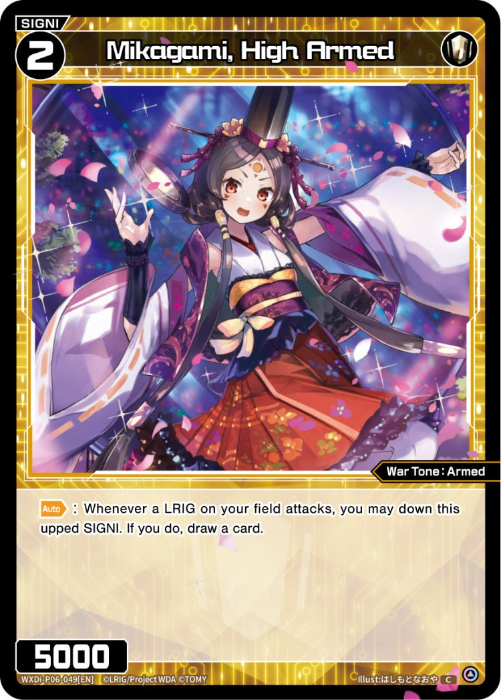

# Mikagami, High Armed

## Thông tin lá

| Trường | Giá trị |
| --- | --- |
| Mã in | WXDi-P06-049[EN] |
| Set | WXDi-P06[EN] |
| Số thứ tự | 049 |
| Loại thẻ | SIGNI |
| Vị trí | Main Deck |
| Số bản | — (set booster, không áp dụng) |
| Màu | Trắng |
| Độ hiếm | C,C(P) |
| Minh họa | はしもとなおや |
| Level | 2 |
| Limit | — |
| Power | 5000 |
| LRIG type / Class | War Tone：Armed |
| Team / Master | — |
| Cost | — |
| Grow cost | — |
| Use timing | — |
| Life Burst | Không |

## Card text chính thức

[Auto]: Whenever a LRIG on your field attacks, you may down this upped SIGNI. If you do, draw a card.

## Power text / Life Burst

—

## Ghi chú minh họa
Artist: はしもとなおや. Ảnh C được tải từ Card List tiếng Anh.

## FAQ chính thức

**Q. When there are two of this SIGNI on the field, my LRIG attacked. Does each the ability of 《Mikagami, High Armed》 trigger?**
A. Yes, even a single attack triggers each of the ability of 《Mikagami, High Armed》, and if both are down, you may draw two cards.

## Ảnh biến thể

- [C(P)](../images/WXDi-P06-049P-EN.jpg)

## Nguồn
[Card List/FAQ chính thức](https://www.takaratomy.co.jp/products/en.wixoss/card/card.html?card_no=WXDi-P06-049%5BEN%5D ) · [Ảnh thẻ](https://www.takaratomy.co.jp/products/en.wixoss/card/thumb/WXDi-P06-049%5BEN%5D.jpg)
