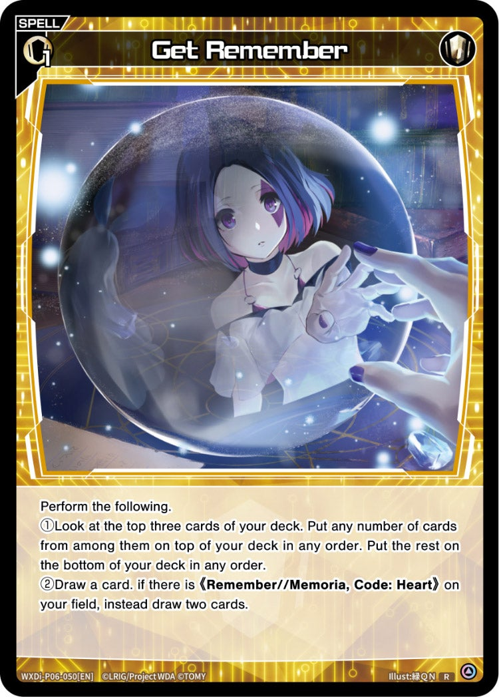

# Get Remember

## Thông tin lá

| Trường | Giá trị |
| --- | --- |
| Mã in | WXDi-P06-050[EN] |
| Set | WXDi-P06[EN] |
| Số thứ tự | 050 |
| Loại thẻ | SPELL |
| Vị trí | Main Deck |
| Số bản | — (set booster, không áp dụng) |
| Màu | Trắng |
| Độ hiếm | R,R(P) |
| Minh họa | 緑ＱＮ |
| Level | — |
| Limit | — |
| Power | 0 |
| LRIG type / Class | — |
| Team / Master | — |
| Cost | 《W》×１ |
| Grow cost | — |
| Use timing | — |
| Life Burst | Không |

## Card text chính thức

Perform the following.
①Look at the top three cards of your deck. Put any number of cards from among them on top of your deck in any order. Put the rest on the bottom of your deck in any order.
②Draw a card. if there is 《Remember//Memoria, Code: Heart》 on your field, instead draw two cards.

## Power text / Life Burst

—

## Ghi chú minh họa
Artist: 緑ＱＮ. Ảnh R được tải từ Card List tiếng Anh.

## FAQ chính thức

**Q. May I do ② first and then ①?**
A. No, you cannot. Effects are processed in order from the top, so they must be done in the order ① and ②.

## Ảnh biến thể

- [R(P)](../images/WXDi-P06-050P-EN.jpg)

## Nguồn
[Card List/FAQ chính thức](https://www.takaratomy.co.jp/products/en.wixoss/card/card.html?card_no=WXDi-P06-050%5BEN%5D ) · [Ảnh thẻ](https://www.takaratomy.co.jp/products/en.wixoss/card/thumb/WXDi-P06-050%5BEN%5D.jpg)
