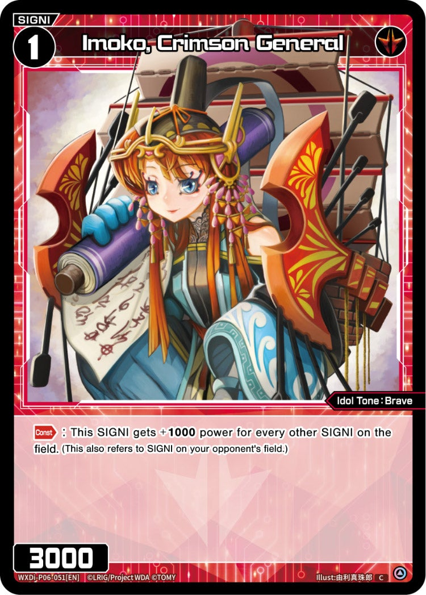

# Imoko, Crimson General

## Thông tin lá

| Trường | Giá trị |
| --- | --- |
| Mã in | WXDi-P06-051[EN] |
| Set | WXDi-P06[EN] |
| Số thứ tự | 051 |
| Loại thẻ | SIGNI |
| Vị trí | Main Deck |
| Số bản | — (set booster, không áp dụng) |
| Màu | Đỏ |
| Độ hiếm | C,C(P) |
| Minh họa | 由利真珠郎 |
| Level | 1 |
| Limit | — |
| Power | 3000 |
| LRIG type / Class | Idol Tone：Brave |
| Team / Master | — |
| Cost | — |
| Grow cost | — |
| Use timing | — |
| Life Burst | Không |

## Card text chính thức

[Constant]: This SIGNI gets +1000 power for every other SIGNI on the field. (This also refers to SIGNI on your opponent's field.)

## Power text / Life Burst

—

## Ghi chú minh họa
Artist: 由利真珠郎. Ảnh C được tải từ Card List tiếng Anh.

## FAQ chính thức

**Q. Does this SIGNI's [Constant] ability also count SIGNI in Ener zone or in hand?**
A. No. Only SIGNI on the field as SIGNI count.

## Ảnh biến thể

- [C(P)](../images/WXDi-P06-051P-EN.jpg)

## Nguồn
[Card List/FAQ chính thức](https://www.takaratomy.co.jp/products/en.wixoss/card/card.html?card_no=WXDi-P06-051%5BEN%5D ) · [Ảnh thẻ](https://www.takaratomy.co.jp/products/en.wixoss/card/thumb/WXDi-P06-051%5BEN%5D.jpg)
