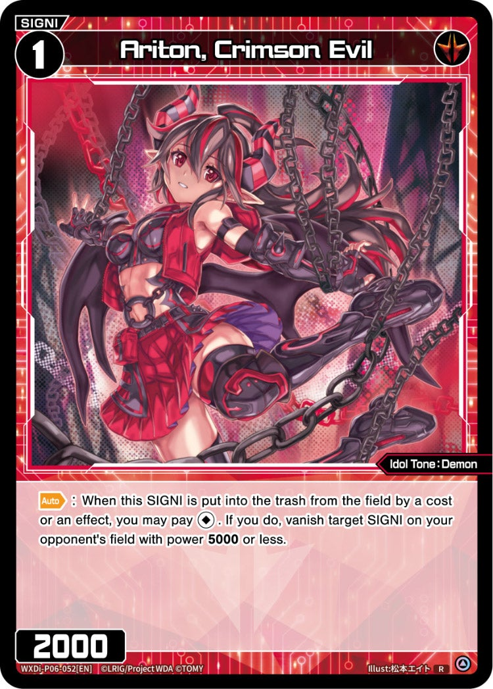

# Ariton, Crimson Evil

## Thông tin lá

| Trường | Giá trị |
| --- | --- |
| Mã in | WXDi-P06-052[EN] |
| Set | WXDi-P06[EN] |
| Số thứ tự | 052 |
| Loại thẻ | SIGNI |
| Vị trí | Main Deck |
| Số bản | — (set booster, không áp dụng) |
| Màu | Đỏ |
| Độ hiếm | R,R(P) |
| Minh họa | 松本エイト |
| Level | 1 |
| Limit | — |
| Power | 2000 |
| LRIG type / Class | Idol Tone：Demon |
| Team / Master | — |
| Cost | — |
| Grow cost | — |
| Use timing | — |
| Life Burst | Không |

## Card text chính thức

[Auto]: When this SIGNI is put into the trash from the field by a cost or an effect, you may pay {Colorless}. If you do, vanish target SIGNI on your opponent's field with power 5000 or less.

## Power text / Life Burst

—

## Ghi chú minh họa
Artist: 松本エイト. Ảnh R được tải từ Card List tiếng Anh.

## FAQ chính thức

**Q. If this SIGNI is vanished by an attack of 《Chandelier, Code: Art》 and put it into my trash instead of my Ener zone, does the [Auto] ability trigger?**
A. No, it does not trigger. The "SIGNI vanished by this SIGNI is put into the trash instead of the Ener Zone" of 《Chandelier, Code: Art》etc. only changes the placement due to the result of being vanished. 《Chandelier, Code: Art》 is not directly moved into the trash by the effect of 《Chandelier, Code: Art》. Since this move is due to an attack, it is a move that is neither an effect or a cost and does not trigger the [Auto] ability.

## Ảnh biến thể

- [R(P)](../images/WXDi-P06-052P-EN.jpg)

## Nguồn
[Card List/FAQ chính thức](https://www.takaratomy.co.jp/products/en.wixoss/card/card.html?card_no=WXDi-P06-052%5BEN%5D ) · [Ảnh thẻ](https://www.takaratomy.co.jp/products/en.wixoss/card/thumb/WXDi-P06-052%5BEN%5D.jpg)
