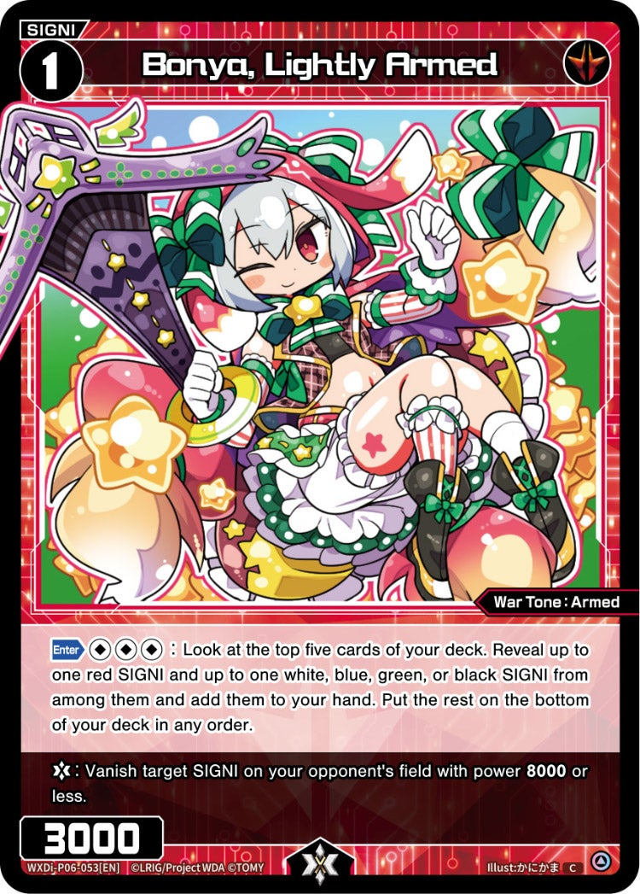

# Bonya, Lightly Armed

## Thông tin lá

| Trường | Giá trị |
| --- | --- |
| Mã in | WXDi-P06-053[EN] |
| Set | WXDi-P06[EN] |
| Số thứ tự | 053 |
| Loại thẻ | SIGNI |
| Vị trí | Main Deck |
| Số bản | — (set booster, không áp dụng) |
| Màu | Đỏ |
| Độ hiếm | C,C(P) |
| Minh họa | かにかま |
| Level | 1 |
| Limit | — |
| Power | 3000 |
| LRIG type / Class | War Tone：Armed |
| Team / Master | — |
| Cost | — |
| Grow cost | — |
| Use timing | — |
| Life Burst | Có |

## Card text chính thức

[Enter] {Colorless} {Colorless} {Colorless}: Look at the top five cards of your deck. Reveal up to one red SIGNI and up to one white, blue, green, or black SIGNI from among them and add them to your hand. Put the rest on the bottom of your deck in any order.

## Power text / Life Burst

Vanish target SIGNI on your opponent's field with power 8000 or less.

## Ghi chú minh họa
Artist: かにかま. Ảnh C được tải từ Card List tiếng Anh.

## FAQ chính thức

**Q. What happens if there are five or less cards in my deck when the [Enter] ability is triggered?**
A. In that case, the effect is processed by looking at those five  or less cards. If more than one card remains in your deck after the effect is processed, you don't refresh your deck.

## Ảnh biến thể

- [C(P)](../images/WXDi-P06-053P-EN.jpg)

## Nguồn
[Card List/FAQ chính thức](https://www.takaratomy.co.jp/products/en.wixoss/card/card.html?card_no=WXDi-P06-053%5BEN%5D ) · [Ảnh thẻ](https://www.takaratomy.co.jp/products/en.wixoss/card/thumb/WXDi-P06-053%5BEN%5D.jpg)
