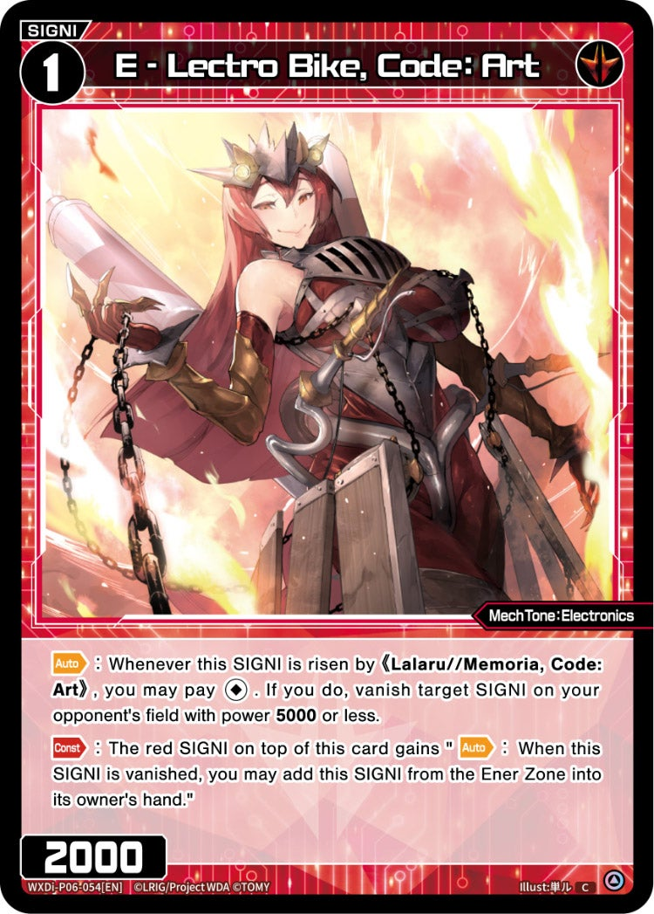

# E - Lectro Bike, Code: Art

## Thông tin lá

| Trường | Giá trị |
| --- | --- |
| Mã in | WXDi-P06-054[EN] |
| Set | WXDi-P06[EN] |
| Số thứ tự | 054 |
| Loại thẻ | SIGNI |
| Vị trí | Main Deck |
| Số bản | — (set booster, không áp dụng) |
| Màu | Đỏ |
| Độ hiếm | C,C(P) |
| Minh họa | 単ル |
| Level | 1 |
| Limit | — |
| Power | 2000 |
| LRIG type / Class | Mech Tone：Electronics |
| Team / Master | — |
| Cost | — |
| Grow cost | — |
| Use timing | — |
| Life Burst | Không |

## Card text chính thức

[Auto]: Whenever this SIGNI is risen by 《Lalaru//Memoria, Code: Art》, you may pay {Colorless}. If you do, vanish target SIGNI on your opponent's field with power 5000 or less.

[Constant]: The red SIGNI on top of this card gains "[Auto]: When this SIGNI is vanished, you may add this SIGNI from the Ener Zone into its owner's hand."

## Power text / Life Burst

—

## Ghi chú minh họa
Artist: 単ル. Ảnh C được tải từ Card List tiếng Anh.

## FAQ chính thức

— (không có FAQ riêng cho mã này trên trang FAQ tiếng Anh.)

## Ảnh biến thể

- [C(P)](../images/WXDi-P06-054P-EN.jpg)

## Nguồn
[Card List/FAQ chính thức](https://www.takaratomy.co.jp/products/en.wixoss/card/card.html?card_no=WXDi-P06-054%5BEN%5D ) · [Ảnh thẻ](https://www.takaratomy.co.jp/products/en.wixoss/card/thumb/WXDi-P06-054%5BEN%5D.jpg)
