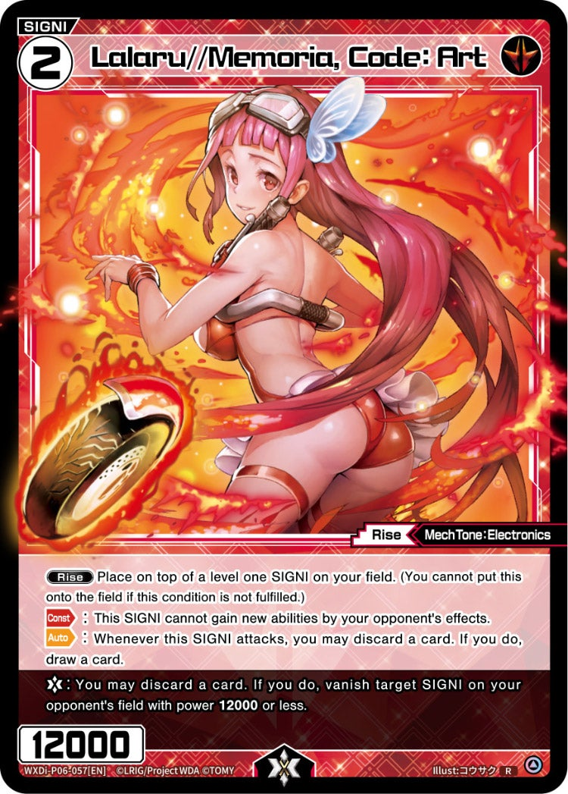

# Lalaru//Memoria, Code: Art

## Thông tin lá

| Trường | Giá trị |
| --- | --- |
| Mã in | WXDi-P06-057[EN] |
| Set | WXDi-P06[EN] |
| Số thứ tự | 057 |
| Loại thẻ | SIGNI |
| Vị trí | Main Deck |
| Số bản | — (set booster, không áp dụng) |
| Màu | Đỏ |
| Độ hiếm | R,R(P) |
| Minh họa | コウサク / ぶんたん |
| Level | 2 |
| Limit | — |
| Power | 12000 |
| LRIG type / Class | Mech Tone：Electronics |
| Team / Master | — |
| Cost | — |
| Grow cost | — |
| Use timing | — |
| Life Burst | Có |

## Card text chính thức

[Rise] Place on top of a level one SIGNI on your field. (You cannot put this onto the field if this condition is not fulfilled.)
[Constant]: This SIGNI cannot gain new abilities by your opponent's effects.
[Auto]: Whenever this SIGNI attacks, you may discard a card. If you do, draw a card.

## Power text / Life Burst

You may discard a card. If you do, vanish target SIGNI on your opponent's field with power 12000 or less.

## Ghi chú minh họa
Artist: コウサク / ぶんたん. Ảnh R được tải từ Card List tiếng Anh.

## FAQ chính thức

**Q. What does "This SIGNI cannot gain new abilities by your opponent's effects." mean?**
A. For example, it will not be able to make this SIGNI gains abilities such as "This SIGNI cannot attack". Effects other than making it gains abilities cannot be prevented, such as effects that down, freeze or effects that negatively affect power.

**Q. When this SIGNI attacks, may I draw a card if there are zero cards in my hand?**
A. No. If you cannot discard a card, you cannot draw a card.

## Ảnh biến thể

- [R(P)](../images/WXDi-P06-057P-EN.jpg)

## Nguồn
[Card List/FAQ chính thức](https://www.takaratomy.co.jp/products/en.wixoss/card/card.html?card_no=WXDi-P06-057%5BEN%5D ) · [Ảnh thẻ](https://www.takaratomy.co.jp/products/en.wixoss/card/thumb/WXDi-P06-057%5BEN%5D.jpg)
