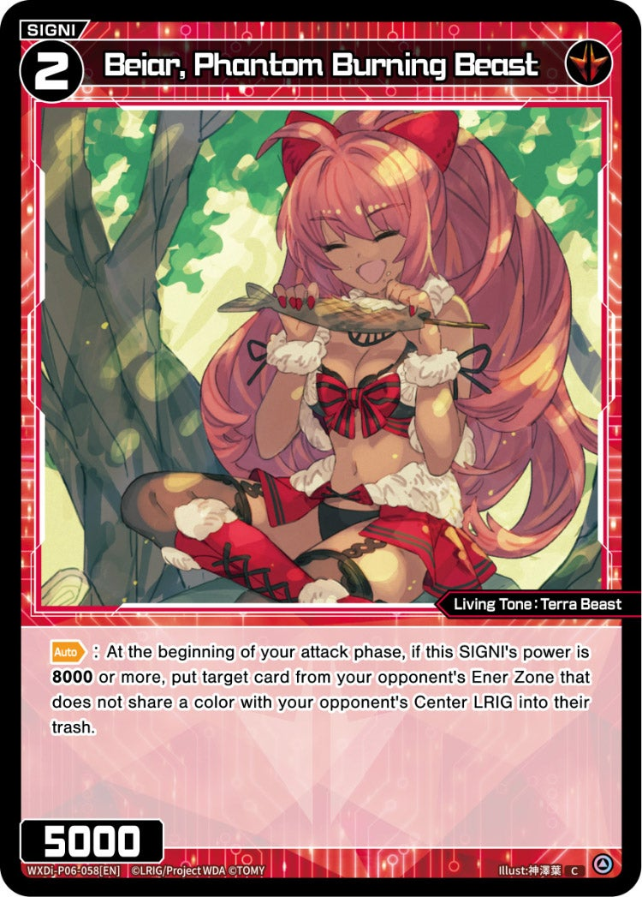

# Beiar, Phantom Burning Beast

## Thông tin lá

| Trường | Giá trị |
| --- | --- |
| Mã in | WXDi-P06-058[EN] |
| Set | WXDi-P06[EN] |
| Số thứ tự | 058 |
| Loại thẻ | SIGNI |
| Vị trí | Main Deck |
| Số bản | — (set booster, không áp dụng) |
| Màu | Đỏ |
| Độ hiếm | C,C(P) |
| Minh họa | 神澤葉 |
| Level | 2 |
| Limit | — |
| Power | 5000 |
| LRIG type / Class | Living Tone：Terra Beast |
| Team / Master | — |
| Cost | — |
| Grow cost | — |
| Use timing | — |
| Life Burst | Không |

## Card text chính thức

[Auto]: At the beginning of your attack phase, if this SIGNI's power is 8000 or more, put target card from your opponent's Ener Zone that does not share a color with your opponent's Center LRIG into their trash.

## Power text / Life Burst

—

## Ghi chú minh họa
Artist: 神澤葉. Ảnh C được tải từ Card List tiếng Anh.

## FAQ chính thức

**Q. May I use this [Auto] ability to put a 《Servant ♯》 in my opponent's Ener zone into its owner's trash?**
A. Yes, you can put it into its owner's trash. Colorless SIGNI dose not have color, so it has no colors in common with any of LRIGs.

## Ảnh biến thể

- [C(P)](../images/WXDi-P06-058P-EN.jpg)

## Nguồn
[Card List/FAQ chính thức](https://www.takaratomy.co.jp/products/en.wixoss/card/card.html?card_no=WXDi-P06-058%5BEN%5D ) · [Ảnh thẻ](https://www.takaratomy.co.jp/products/en.wixoss/card/thumb/WXDi-P06-058%5BEN%5D.jpg)
