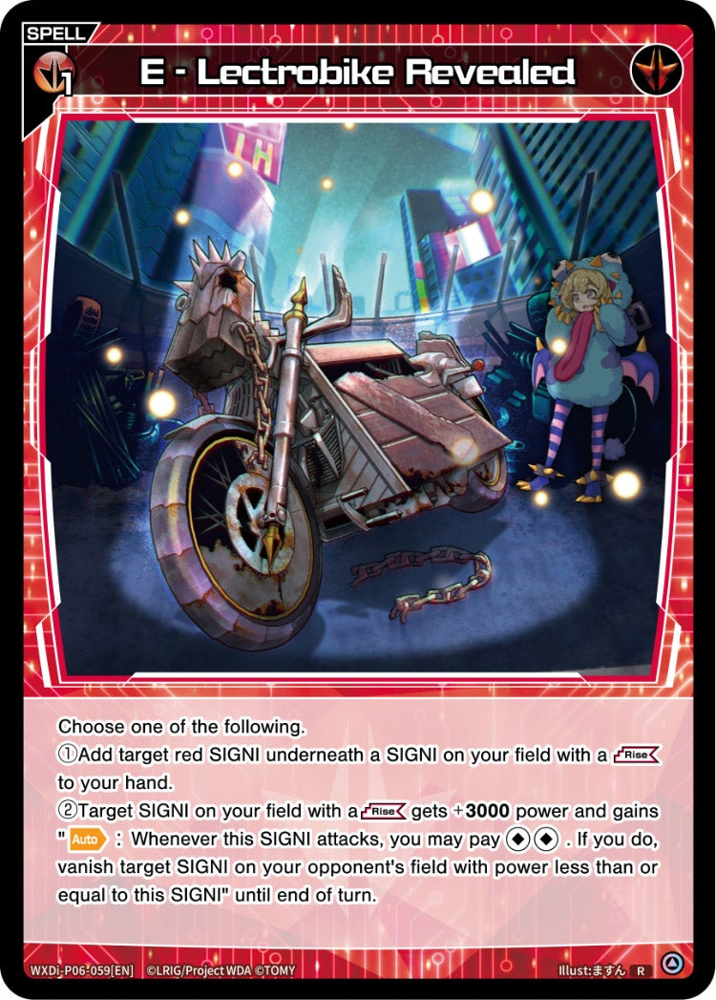

# E - Lectrobike Revealed

## Thông tin lá

| Trường | Giá trị |
| --- | --- |
| Mã in | WXDi-P06-059[EN] |
| Set | WXDi-P06[EN] |
| Số thứ tự | 059 |
| Loại thẻ | SPELL |
| Vị trí | Main Deck |
| Số bản | — (set booster, không áp dụng) |
| Màu | Đỏ |
| Độ hiếm | R,R(P) |
| Minh họa | ますん |
| Level | — |
| Limit | — |
| Power | 0 |
| LRIG type / Class | — |
| Team / Master | — |
| Cost | 《R》×１ |
| Grow cost | — |
| Use timing | — |
| Life Burst | Không |

## Card text chính thức

Choose one of the following.
①Add target red SIGNI underneath a SIGNI on your field with a {Rise Icon} to your hand.
②Target SIGNI on your field with a {Rise Icon} gets +3000 power and gains "[Auto]: Whenever this SIGNI attacks, you may pay {Colorless} {Colorless}. If you do, vanish target SIGNI on your opponent's field with power less than or equal to this SIGNI" until end of turn.

## Power text / Life Burst

—

## Ghi chú minh họa
Artist: ますん. Ảnh R được tải từ Card List tiếng Anh.

## FAQ chính thức

— (không có FAQ riêng cho mã này trên trang FAQ tiếng Anh.)

## Ảnh biến thể

- [R(P)](../images/WXDi-P06-059P-EN.jpg)

## Nguồn
[Card List/FAQ chính thức](https://www.takaratomy.co.jp/products/en.wixoss/card/card.html?card_no=WXDi-P06-059%5BEN%5D ) · [Ảnh thẻ](https://www.takaratomy.co.jp/products/en.wixoss/card/thumb/WXDi-P06-059%5BEN%5D.jpg)
