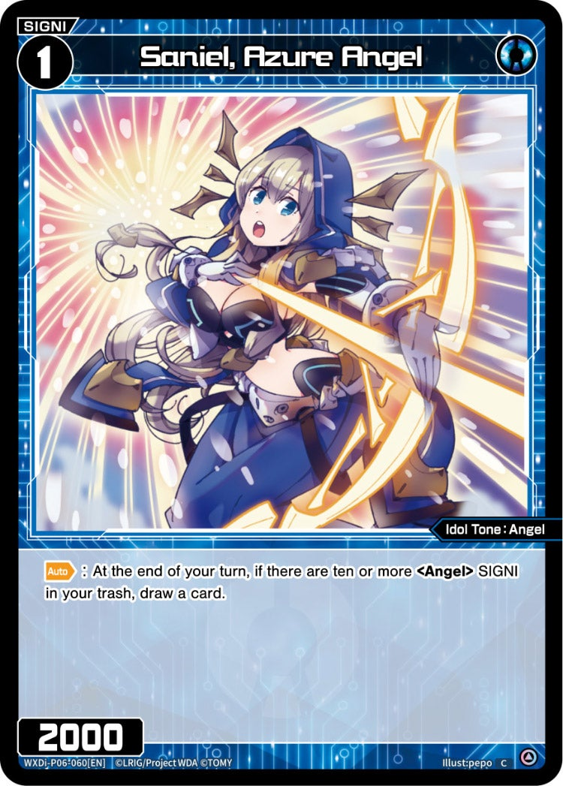

# Saniel, Azure Angel

## Thông tin lá

| Trường | Giá trị |
| --- | --- |
| Mã in | WXDi-P06-060[EN] |
| Set | WXDi-P06[EN] |
| Số thứ tự | 060 |
| Loại thẻ | SIGNI |
| Vị trí | Main Deck |
| Số bản | — (set booster, không áp dụng) |
| Màu | Xanh dương |
| Độ hiếm | C,C(P) |
| Minh họa | pepo |
| Level | 1 |
| Limit | — |
| Power | 2000 |
| LRIG type / Class | Idol Tone：Angel |
| Team / Master | — |
| Cost | — |
| Grow cost | — |
| Use timing | — |
| Life Burst | Không |

## Card text chính thức

[Auto]: At the end of your turn, if there are ten or more <Angel> SIGNI in your trash, draw a card.

## Power text / Life Burst

—

## Ghi chú minh họa
Artist: pepo. Ảnh C được tải từ Card List tiếng Anh.

## FAQ chính thức

**Q. At the end of turn, the [Auto] ability triggers and I drew a card, and I have seven cards in my hand. Do I need to discard to get to six cards?**
A. Yes, in that case, discard cards so that you have six cards in your hand. In the end phase, the [Auto] ability triggered at the end of turn is triggered first, then the "Until end of turn" effect ends, and if you have seven or more cards in your hand, discard so that there are six cards.

**Q. As a result of the end of turn process to discard cards in your hand to six cards, I have ten or more <Angel> SIGNI in my trash. Does this [Auto] ability trigger that turn?**
A. No, it does not trigger. This [Auto] ability is triggered immediately in the end phase, before the end of turn process discards your hand to six cards.

## Ảnh biến thể

- [C(P)](../images/WXDi-P06-060P-EN.jpg)

## Nguồn
[Card List/FAQ chính thức](https://www.takaratomy.co.jp/products/en.wixoss/card/card.html?card_no=WXDi-P06-060%5BEN%5D ) · [Ảnh thẻ](https://www.takaratomy.co.jp/products/en.wixoss/card/thumb/WXDi-P06-060%5BEN%5D.jpg)
