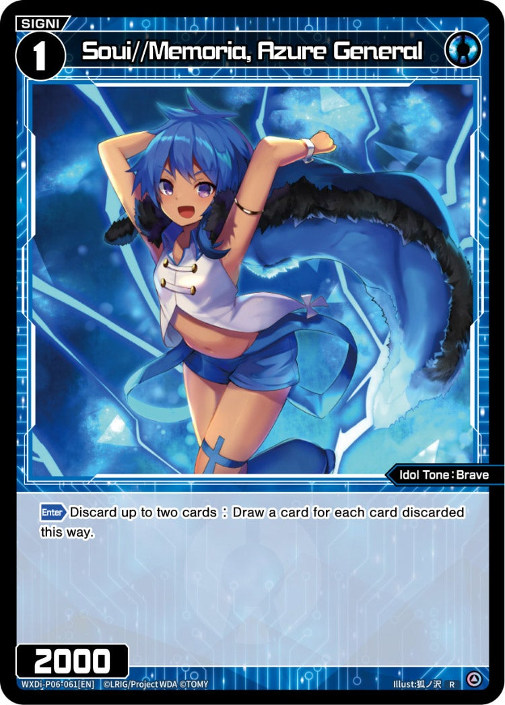

# Soui//Memoria, Azure General

## Thông tin lá

| Trường | Giá trị |
| --- | --- |
| Mã in | WXDi-P06-061[EN] |
| Set | WXDi-P06[EN] |
| Số thứ tự | 061 |
| Loại thẻ | SIGNI |
| Vị trí | Main Deck |
| Số bản | — (set booster, không áp dụng) |
| Màu | Xanh dương |
| Độ hiếm | R,R(P) |
| Minh họa | 狐ノ沢 / エイチ |
| Level | 1 |
| Limit | — |
| Power | 2000 |
| LRIG type / Class | Idol Tone：Brave |
| Team / Master | — |
| Cost | — |
| Grow cost | — |
| Use timing | — |
| Life Burst | Không |

## Card text chính thức

[Enter] Discard up to two cards: Draw a card for each card discarded this way.

## Power text / Life Burst

—

## Ghi chú minh họa
Artist: 狐ノ沢 / エイチ. Ảnh R được tải từ Card List tiếng Anh.

## FAQ chính thức

**Q. May I choose to discard zero cards by this [Enter] ability?**
A. Yes, you can choose. In this case, no card can be drawn.

## Ảnh biến thể

- [R(P)](../images/WXDi-P06-061P-EN.jpg)

## Nguồn
[Card List/FAQ chính thức](https://www.takaratomy.co.jp/products/en.wixoss/card/card.html?card_no=WXDi-P06-061%5BEN%5D ) · [Ảnh thẻ](https://www.takaratomy.co.jp/products/en.wixoss/card/thumb/WXDi-P06-061%5BEN%5D.jpg)
