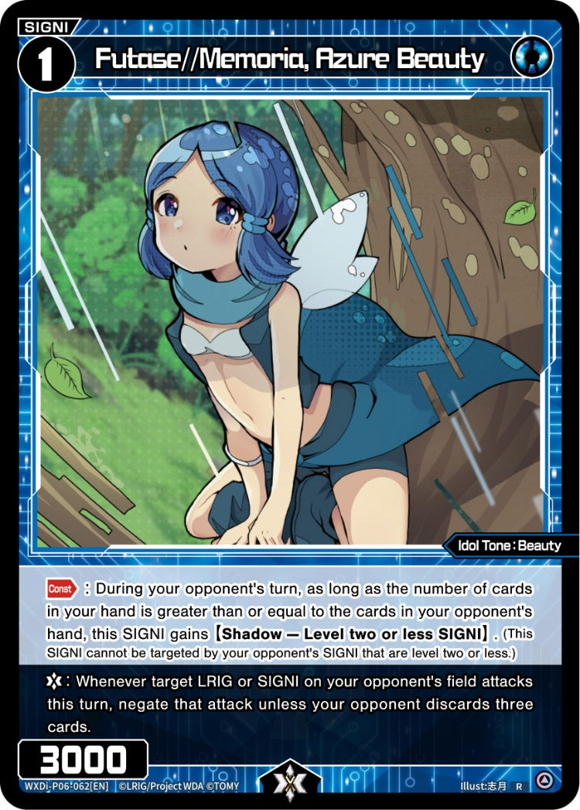

# Futase//Memoria, Azure Beauty

## Thông tin lá

| Trường | Giá trị |
| --- | --- |
| Mã in | WXDi-P06-062[EN] |
| Set | WXDi-P06[EN] |
| Số thứ tự | 062 |
| Loại thẻ | SIGNI |
| Vị trí | Main Deck |
| Số bản | — (set booster, không áp dụng) |
| Màu | Xanh dương |
| Độ hiếm | R,R(P) |
| Minh họa | 志月 / pepo |
| Level | 1 |
| Limit | — |
| Power | 3000 |
| LRIG type / Class | Idol Tone：Beauty |
| Team / Master | — |
| Cost | — |
| Grow cost | — |
| Use timing | — |
| Life Burst | Có |

## Card text chính thức

[Constant]: During your opponent's turn, as long as the number of cards in your hand is greater than or equal to the cards in your opponent's hand, this SIGNI gains 【Shadow — Level two or less SIGNI】. (This SIGNI cannot be targeted by your opponent's SIGNI that are level two or less.)

## Power text / Life Burst

Whenever target LRIG or SIGNI on your opponent's field attacks this turn, negate that attack unless your opponent discards three cards.

## Ghi chú minh họa
Artist: 志月 / pepo. Ảnh R được tải từ Card List tiếng Anh.

## FAQ chính thức

**Q. If both players have zero cards in their hand, does this SIGNI gain 【Shadow - Level two or less SIGNI】?**
A. Yes, even if there are zero cards in each player's hand, there are the total number of cards or more in your opponent's hand, so that SIGNI gains 【Shadow - Level two or less SIGNI】.

## Ảnh biến thể

- [R(P)](../images/WXDi-P06-062P-EN.jpg)

## Nguồn
[Card List/FAQ chính thức](https://www.takaratomy.co.jp/products/en.wixoss/card/card.html?card_no=WXDi-P06-062%5BEN%5D ) · [Ảnh thẻ](https://www.takaratomy.co.jp/products/en.wixoss/card/thumb/WXDi-P06-062%5BEN%5D.jpg)
