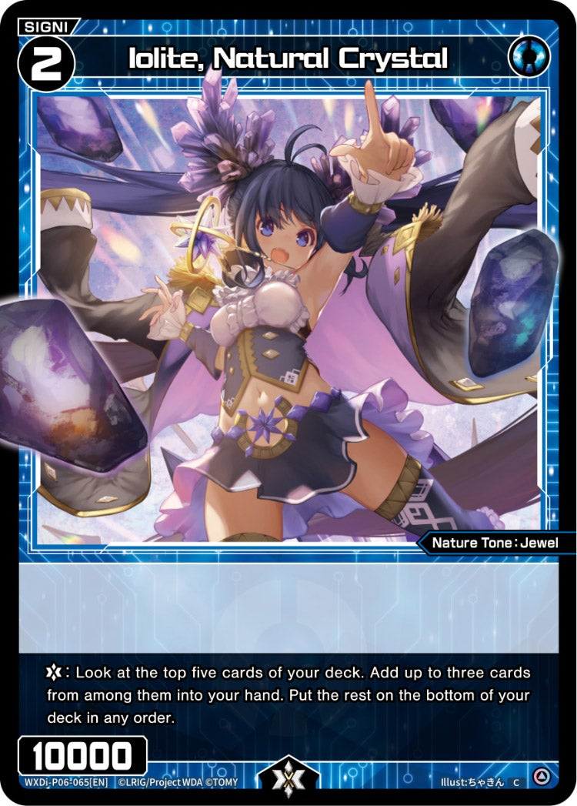

# Iolite, Natural Crystal

## Thông tin lá

| Trường | Giá trị |
| --- | --- |
| Mã in | WXDi-P06-065[EN] |
| Set | WXDi-P06[EN] |
| Số thứ tự | 065 |
| Loại thẻ | SIGNI |
| Vị trí | Main Deck |
| Số bản | — (set booster, không áp dụng) |
| Màu | Xanh dương |
| Độ hiếm | C,C(P) |
| Minh họa | ちゃきん |
| Level | 2 |
| Limit | — |
| Power | 10000 |
| LRIG type / Class | Nature Tone：Jewel |
| Team / Master | — |
| Cost | — |
| Grow cost | — |
| Use timing | — |
| Life Burst | Có |

## Card text chính thức

—

## Power text / Life Burst

Look at the top five cards of your deck. Add up to three cards from among them into your hand. Put the rest on the bottom of your deck in any order.

## Ghi chú minh họa
Artist: ちゃきん. Ảnh C được tải từ Card List tiếng Anh.

## FAQ chính thức

**Q. What happens if there are five or less cards in my deck when the Life Burst is triggered?**
A. In that case, the effect is processed by looking at those five  or less cards. If more than one card remains in your deck after the effect is processed, you don't refresh your deck.

## Ảnh biến thể

- [C(P)](../images/WXDi-P06-065P-EN.jpg)

## Nguồn
[Card List/FAQ chính thức](https://www.takaratomy.co.jp/products/en.wixoss/card/card.html?card_no=WXDi-P06-065%5BEN%5D ) · [Ảnh thẻ](https://www.takaratomy.co.jp/products/en.wixoss/card/thumb/WXDi-P06-065%5BEN%5D.jpg)
