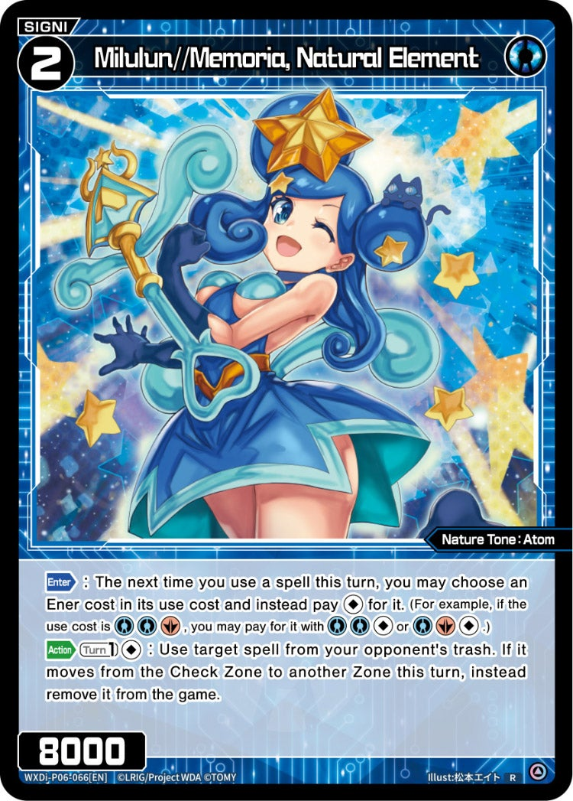

# Milulun//Memoria, Natural Element

## Thông tin lá

| Trường | Giá trị |
| --- | --- |
| Mã in | WXDi-P06-066[EN] |
| Set | WXDi-P06[EN] |
| Số thứ tự | 066 |
| Loại thẻ | SIGNI |
| Vị trí | Main Deck |
| Số bản | — (set booster, không áp dụng) |
| Màu | Xanh dương |
| Độ hiếm | R,R(P) |
| Minh họa | 松本エイト / かにゃぴぃ |
| Level | 2 |
| Limit | — |
| Power | 8000 |
| LRIG type / Class | Nature Tone：Atom |
| Team / Master | — |
| Cost | — |
| Grow cost | — |
| Use timing | — |
| Life Burst | Không |

## Card text chính thức

[Enter]: The next time you use a spell this turn, you may choose an Ener cost in its use cost and instead pay {Colorless} for it. (For example, if the use cost is {Blue} {Blue} {Red}, you may pay for it with {Blue} {Blue} {Colorless} or {Blue} {Red} {Colorless}.)
[Action] {1/Turn} {Colorless}: Use target spell from your opponent's trash. If it moves from the Check Zone to another Zone this turn, instead remove it from the game.

## Power text / Life Burst

—

## Ghi chú minh họa
Artist: 松本エイト / かにゃぴぃ. Ảnh R được tải từ Card List tiếng Anh.

## FAQ chính thức

**Q. If I use the [Action] ability after resolving the [Enter] ability, may I pay part of the Ener cost as {Colorlessuse} by using my opponent's spell?**
A. Yes, you can.

**Q. After I put this SIGNI and resolved its [Enter] ability, I used a spell with an Energy cost of 《Colorless》 x0. If I use another spell after that, may the effect of the [Enter] ability be applied?**
A. No, you cannot. Even if the next spell after the [Enter] ability is a spell that does not need to pay an Ener cost, the effect of the [Enter] ability is applied to that spell. Furthermore, the effect cannot be applied to the next spell after that.

**Q. May my opponent use 【Spell cut-in】 when I use my opponent's spell by this [Action] ability?**
A. Yes, your opponent can.

## Ảnh biến thể

- [R(P)](../images/WXDi-P06-066P-EN.jpg)

## Nguồn
[Card List/FAQ chính thức](https://www.takaratomy.co.jp/products/en.wixoss/card/card.html?card_no=WXDi-P06-066%5BEN%5D ) · [Ảnh thẻ](https://www.takaratomy.co.jp/products/en.wixoss/card/thumb/WXDi-P06-066%5BEN%5D.jpg)
