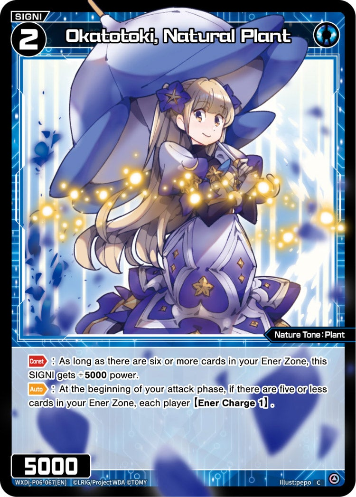

# Okatotoki, Natural Plant

## Thông tin lá

| Trường | Giá trị |
| --- | --- |
| Mã in | WXDi-P06-067[EN] |
| Set | WXDi-P06[EN] |
| Số thứ tự | 067 |
| Loại thẻ | SIGNI |
| Vị trí | Main Deck |
| Số bản | — (set booster, không áp dụng) |
| Màu | Xanh dương |
| Độ hiếm | C,C(P) |
| Minh họa | pepo |
| Level | 2 |
| Limit | — |
| Power | 5000 |
| LRIG type / Class | Nature Tone：Plant |
| Team / Master | — |
| Cost | — |
| Grow cost | — |
| Use timing | — |
| Life Burst | Không |

## Card text chính thức

[Constant]: As long as there are six or more cards in your Ener Zone, this SIGNI gets +5000 power.
[Auto]: At the beginning of your attack phase, if there are five or less cards in your Ener Zone, each player 【Ener Charge 1】.

## Power text / Life Burst

—

## Ghi chú minh họa
Artist: pepo. Ảnh C được tải từ Card List tiếng Anh.

## FAQ chính thức

**Q. What happens to the [Auto] ability if there are two these SIGNI on the field and five cards in my Ener zone?**
A. The [Auto] ability of those two SIGNI triggers and is processed in turn, as a result of resolving the first SIGNI's ability and 【Energize 1】, there are six cards in your Ener zone, so the second SIGNI's ability is out of condition and cannot Ener charge.

## Ảnh biến thể

- [C(P)](../images/WXDi-P06-067P-EN.jpg)

## Nguồn
[Card List/FAQ chính thức](https://www.takaratomy.co.jp/products/en.wixoss/card/card.html?card_no=WXDi-P06-067%5BEN%5D ) · [Ảnh thẻ](https://www.takaratomy.co.jp/products/en.wixoss/card/thumb/WXDi-P06-067%5BEN%5D.jpg)
