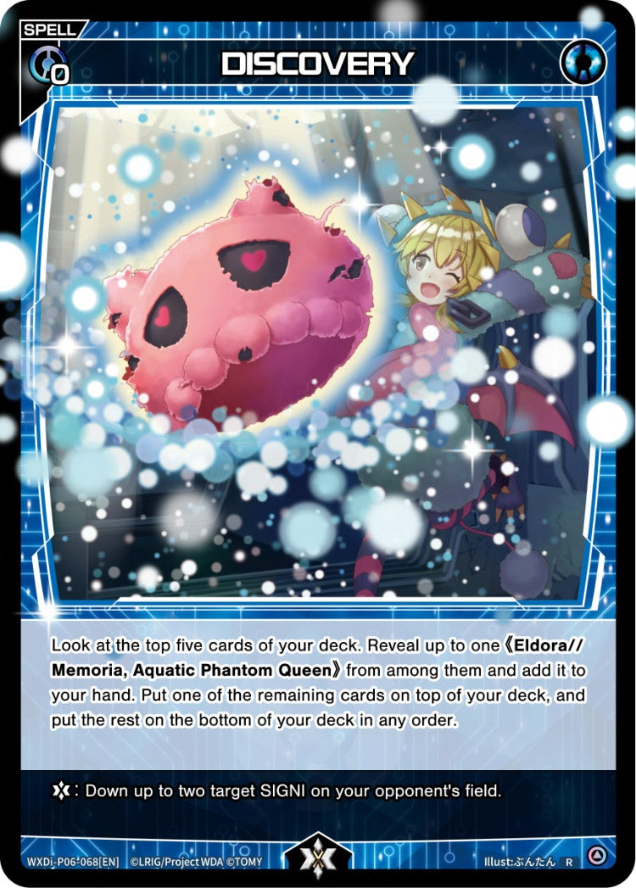

# DISCOVERY

## Thông tin lá

| Trường | Giá trị |
| --- | --- |
| Mã in | WXDi-P06-068[EN] |
| Set | WXDi-P06[EN] |
| Số thứ tự | 068 |
| Loại thẻ | SPELL |
| Vị trí | Main Deck |
| Số bản | — (set booster, không áp dụng) |
| Màu | Xanh dương |
| Độ hiếm | R,R(P) |
| Minh họa | ぶんたん |
| Level | — |
| Limit | — |
| Power | 0 |
| LRIG type / Class | — |
| Team / Master | — |
| Cost | 《U》×０ |
| Grow cost | — |
| Use timing | — |
| Life Burst | Có |

## Card text chính thức

Look at the top five cards of your deck. Reveal up to one 《Eldora//Memoria, Aquatic Phantom Queen》 from among them and add it to your hand. Put one of the remaining cards on top of your deck, and put the rest on the bottom of your deck in any order.

## Power text / Life Burst

Down up to two target SIGNI on your opponent's field.

## Ghi chú minh họa
Artist: ぶんたん. Ảnh R được tải từ Card List tiếng Anh.

## FAQ chính thức

**Q. When I used this spell, may I put every cards to the bottom of my deck without putting any cards on the top of my deck?**
A. No, you cannot. After looking at the top of your deck and revealing up to one 《Eldora//Memoria, Aquatic Phantom Queen》 and add it to your hand, always put one of the remaining cards on the top of your deck.

**Q. Does this effect reveal the card to be put at the top or bottom of my deck?**
A. No, it does not have to be revealed.

## Ảnh biến thể

- [R(P)](../images/WXDi-P06-068P-EN.jpg)

## Nguồn
[Card List/FAQ chính thức](https://www.takaratomy.co.jp/products/en.wixoss/card/card.html?card_no=WXDi-P06-068%5BEN%5D ) · [Ảnh thẻ](https://www.takaratomy.co.jp/products/en.wixoss/card/thumb/WXDi-P06-068%5BEN%5D.jpg)
