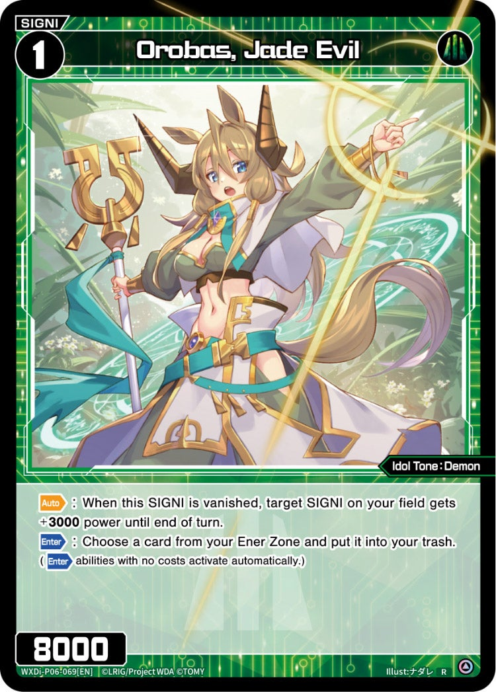

# Orobas, Jade Evil

## Thông tin lá

| Trường | Giá trị |
| --- | --- |
| Mã in | WXDi-P06-069[EN] |
| Set | WXDi-P06[EN] |
| Số thứ tự | 069 |
| Loại thẻ | SIGNI |
| Vị trí | Main Deck |
| Số bản | — (set booster, không áp dụng) |
| Màu | Xanh lá |
| Độ hiếm | R,R(P) |
| Minh họa | ナダレ |
| Level | 1 |
| Limit | — |
| Power | 8000 |
| LRIG type / Class | Idol Tone：Demon |
| Team / Master | — |
| Cost | — |
| Grow cost | — |
| Use timing | — |
| Life Burst | Không |

## Card text chính thức

[Auto]: When this SIGNI is vanished, target SIGNI on your field gets +3000 power until end of turn.
[Enter]: Choose a card from your Ener Zone and put it into your trash.
([Enter] abilities with no costs activate automatically.)

## Power text / Life Burst

—

## Ghi chú minh họa
Artist: ナダレ. Ảnh R được tải từ Card List tiếng Anh.

## FAQ chính thức

**Q. If there are no cards in my Ener zone, may put this SIGNI on the field?**
A. Yes, you can. In that case, the [Enter] ability does nothing.

## Ảnh biến thể

- [R(P)](../images/WXDi-P06-069P-EN.jpg)

## Nguồn
[Card List/FAQ chính thức](https://www.takaratomy.co.jp/products/en.wixoss/card/card.html?card_no=WXDi-P06-069%5BEN%5D ) · [Ảnh thẻ](https://www.takaratomy.co.jp/products/en.wixoss/card/thumb/WXDi-P06-069%5BEN%5D.jpg)
