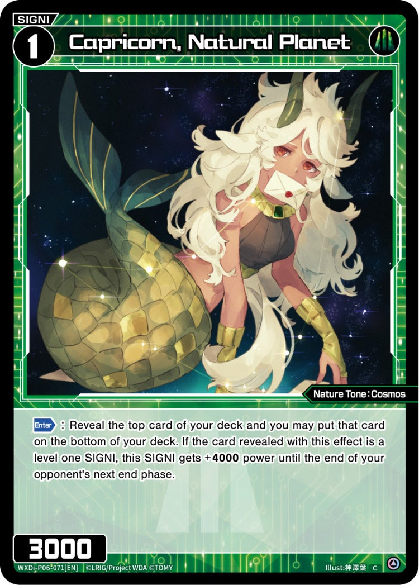

# Capricorn, Natural Planet

## Thông tin lá

| Trường | Giá trị |
| --- | --- |
| Mã in | WXDi-P06-071[EN] |
| Set | WXDi-P06[EN] |
| Số thứ tự | 071 |
| Loại thẻ | SIGNI |
| Vị trí | Main Deck |
| Số bản | — (set booster, không áp dụng) |
| Màu | Xanh lá |
| Độ hiếm | C,C(P) |
| Minh họa | 神澤葉 |
| Level | 1 |
| Limit | — |
| Power | 3000 |
| LRIG type / Class | Nature Tone：Cosmos |
| Team / Master | — |
| Cost | — |
| Grow cost | — |
| Use timing | — |
| Life Burst | Không |

## Card text chính thức

[Enter]: Reveal the top card of your deck and you may put that card on the bottom of your deck. If the card revealed with this effect is a level one SIGNI, this SIGNI gets +4000 power until the end of your opponent's next end phase.

## Power text / Life Burst

—

## Ghi chú minh họa
Artist: 神澤葉. Ảnh C được tải từ Card List tiếng Anh.

## FAQ chính thức

**Q. If the card revealed by the [Enter] ability is a level one SIGNI, may this SIGNI get +4000 power without putting the revealed card to the bottom of my deck?**
A. Yes, that SIGNI gets +4000 power if the revealed card is a level one SIGNI, regardless of whether you put the revealed card at the top or bottom of your deck.

**Q. May I choose not to reveal the top of my deck by the [Enter] ability?**
A. No. It must to be revealed. Afterwards, it is optional whether the card is put on the bottom of your deck or not.

## Ảnh biến thể

- [C(P)](../images/WXDi-P06-071P-EN.jpg)

## Nguồn
[Card List/FAQ chính thức](https://www.takaratomy.co.jp/products/en.wixoss/card/card.html?card_no=WXDi-P06-071%5BEN%5D ) · [Ảnh thẻ](https://www.takaratomy.co.jp/products/en.wixoss/card/thumb/WXDi-P06-071%5BEN%5D.jpg)
