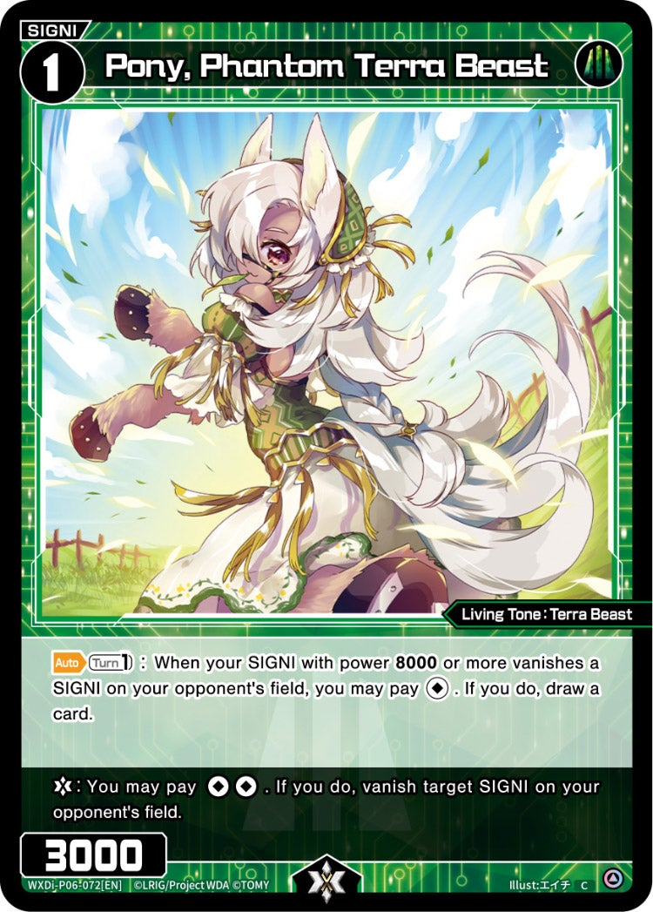

# Pony, Phantom Terra Beast

## Thông tin lá

| Trường | Giá trị |
| --- | --- |
| Mã in | WXDi-P06-072[EN] |
| Set | WXDi-P06[EN] |
| Số thứ tự | 072 |
| Loại thẻ | SIGNI |
| Vị trí | Main Deck |
| Số bản | — (set booster, không áp dụng) |
| Màu | Xanh lá |
| Độ hiếm | C,C(P) |
| Minh họa | エイチ |
| Level | 1 |
| Limit | — |
| Power | 3000 |
| LRIG type / Class | Living Tone：Terra Beast |
| Team / Master | — |
| Cost | — |
| Grow cost | — |
| Use timing | — |
| Life Burst | Có |

## Card text chính thức

[Auto] {1/Turn}: When your SIGNI with power 8000 or more vanishes a SIGNI on your opponent's field, you may pay {Colorless}. If you do, draw a card.

## Power text / Life Burst

You may pay {Colorless} {Colorless}. If you do, vanish target SIGNI on your opponent's field.

## Ghi chú minh họa
Artist: エイチ. Ảnh C được tải từ Card List tiếng Anh.

## FAQ chính thức

**Q. May I draw a card by the [Auto] ability if this SIGNI vanish a SIGNI in battle, even if this SIGNI itself has a power of 8000 or more?**
A. Yes, you can draw a card.

## Ảnh biến thể

- [C(P)](../images/WXDi-P06-072P-EN.jpg)

## Nguồn
[Card List/FAQ chính thức](https://www.takaratomy.co.jp/products/en.wixoss/card/card.html?card_no=WXDi-P06-072%5BEN%5D ) · [Ảnh thẻ](https://www.takaratomy.co.jp/products/en.wixoss/card/thumb/WXDi-P06-072%5BEN%5D.jpg)
