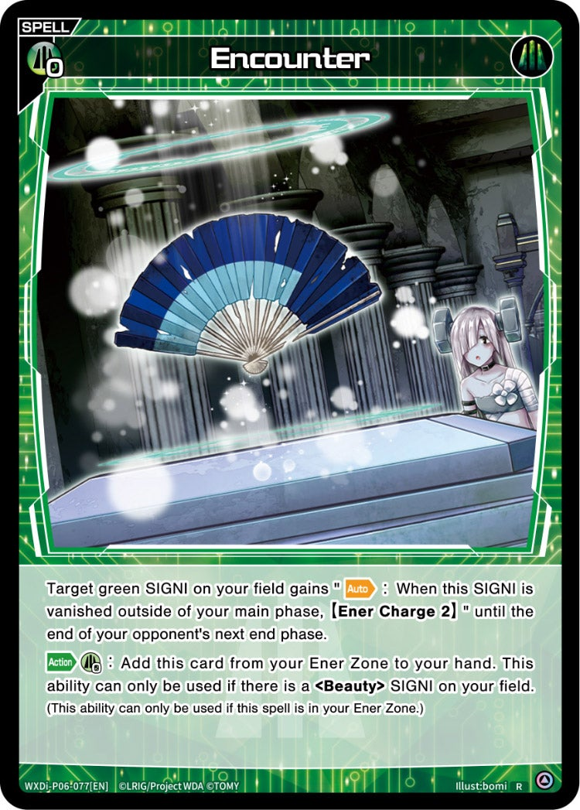

# Encounter

## Thông tin lá

| Trường | Giá trị |
| --- | --- |
| Mã in | WXDi-P06-077[EN] |
| Set | WXDi-P06[EN] |
| Số thứ tự | 077 |
| Loại thẻ | SPELL |
| Vị trí | Main Deck |
| Số bản | — (set booster, không áp dụng) |
| Màu | Xanh lá |
| Độ hiếm | R,R(P) |
| Minh họa | bomi |
| Level | — |
| Limit | — |
| Power | 0 |
| LRIG type / Class | — |
| Team / Master | — |
| Cost | 《G》×０ |
| Grow cost | — |
| Use timing | — |
| Life Burst | Không |

## Card text chính thức

Target green SIGNI on your field gains "[Auto]: When this SIGNI is vanished outside of your main phase, 【Ener Charge 2】" until the end of your opponent's next end phase.

[Action] {Greenx0}: Add this card from your Ener Zone to your hand. This ability can only be used if there is a <Beauty> SIGNI on your field. (This ability can only be used if this spell is in your Ener Zone.)

## Power text / Life Burst

—

## Ghi chú minh họa
Artist: bomi. Ảnh R được tải từ Card List tiếng Anh.

## FAQ chính thức

— (không có FAQ riêng cho mã này trên trang FAQ tiếng Anh.)

## Ảnh biến thể

- [R(P)](../images/WXDi-P06-077P-EN.jpg)

## Nguồn
[Card List/FAQ chính thức](https://www.takaratomy.co.jp/products/en.wixoss/card/card.html?card_no=WXDi-P06-077%5BEN%5D ) · [Ảnh thẻ](https://www.takaratomy.co.jp/products/en.wixoss/card/thumb/WXDi-P06-077%5BEN%5D.jpg)
