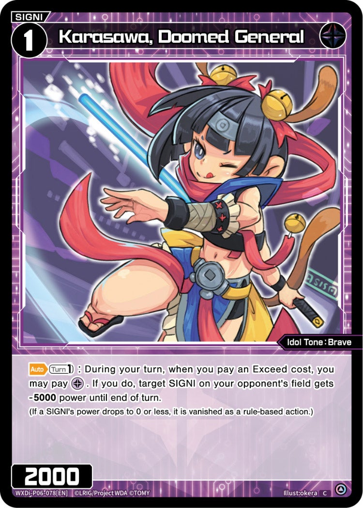

# Karasawa, Doomed General

## Thông tin lá

| Trường | Giá trị |
| --- | --- |
| Mã in | WXDi-P06-078[EN] |
| Set | WXDi-P06[EN] |
| Số thứ tự | 078 |
| Loại thẻ | SIGNI |
| Vị trí | Main Deck |
| Số bản | — (set booster, không áp dụng) |
| Màu | Đen |
| Độ hiếm | C,C(P) |
| Minh họa | okera |
| Level | 1 |
| Limit | — |
| Power | 2000 |
| LRIG type / Class | Idol Tone：Brave |
| Team / Master | — |
| Cost | — |
| Grow cost | — |
| Use timing | — |
| Life Burst | Không |

## Card text chính thức

[Auto] {1/Turn}: During your turn, when you pay an Exceed cost, you may pay {Black}. If you do, target SIGNI on your opponent's field gets -5000 power until end of turn.
(If a SIGNI's power drops to 0 or less, it is vanished as a rule-based action.)

## Power text / Life Burst

—

## Ghi chú minh họa
Artist: okera. Ảnh C được tải từ Card List tiếng Anh.

## FAQ chính thức

**Q. Which is processed first, this [Auto] ability or the ability to have paid an Exceed cost?**
A. The ability that paid the Exceed cost is processed first, after which this [Auto] ability is resolved.

## Ảnh biến thể

- [C(P)](../images/WXDi-P06-078P-EN.jpg)

## Nguồn
[Card List/FAQ chính thức](https://www.takaratomy.co.jp/products/en.wixoss/card/card.html?card_no=WXDi-P06-078%5BEN%5D ) · [Ảnh thẻ](https://www.takaratomy.co.jp/products/en.wixoss/card/thumb/WXDi-P06-078%5BEN%5D.jpg)
