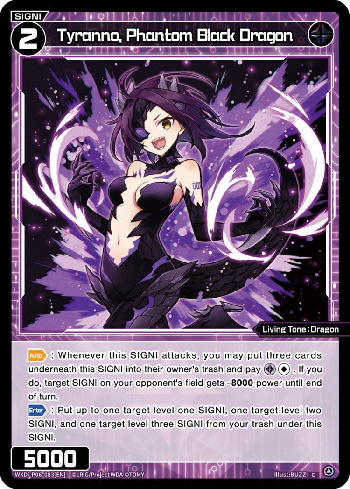

# Tyranno, Phantom Black Dragon

## Thông tin lá

| Trường | Giá trị |
| --- | --- |
| Mã in | WXDi-P06-083[EN] |
| Set | WXDi-P06[EN] |
| Số thứ tự | 083 |
| Loại thẻ | SIGNI |
| Vị trí | Main Deck |
| Số bản | — (set booster, không áp dụng) |
| Màu | Đen |
| Độ hiếm | C,C(P) |
| Minh họa | BUZZ |
| Level | 2 |
| Limit | — |
| Power | 5000 |
| LRIG type / Class | Living Tone：Dragon |
| Team / Master | — |
| Cost | — |
| Grow cost | — |
| Use timing | — |
| Life Burst | Không |

## Card text chính thức

[Auto]: Whenever this SIGNI attacks, you may put three cards underneath this SIGNI into their owner's trash and pay {Black} {Colorless}. If you do, target SIGNI on your opponent's field gets -8000 power until end of turn.
[Enter]: Put up to one target level one SIGNI, one target level two SIGNI, and one target level three SIGNI from your trash under this SIGNI.

## Power text / Life Burst

—

## Ghi chú minh họa
Artist: BUZZ. Ảnh C được tải từ Card List tiếng Anh.

## FAQ chính thức

**Q. Do I have to put a SIGNI in my trash under this SIGNI by the [Enter] ability?**
A. The [Enter] ability without cost must be triggered, but you can choose zero or one card for each level one, level two and level three. You can also choose not to place any cards by choosing all zero cards.

## Ảnh biến thể

- [C(P)](../images/WXDi-P06-083P-EN.jpg)

## Nguồn
[Card List/FAQ chính thức](https://www.takaratomy.co.jp/products/en.wixoss/card/card.html?card_no=WXDi-P06-083%5BEN%5D ) · [Ảnh thẻ](https://www.takaratomy.co.jp/products/en.wixoss/card/thumb/WXDi-P06-083%5BEN%5D.jpg)
