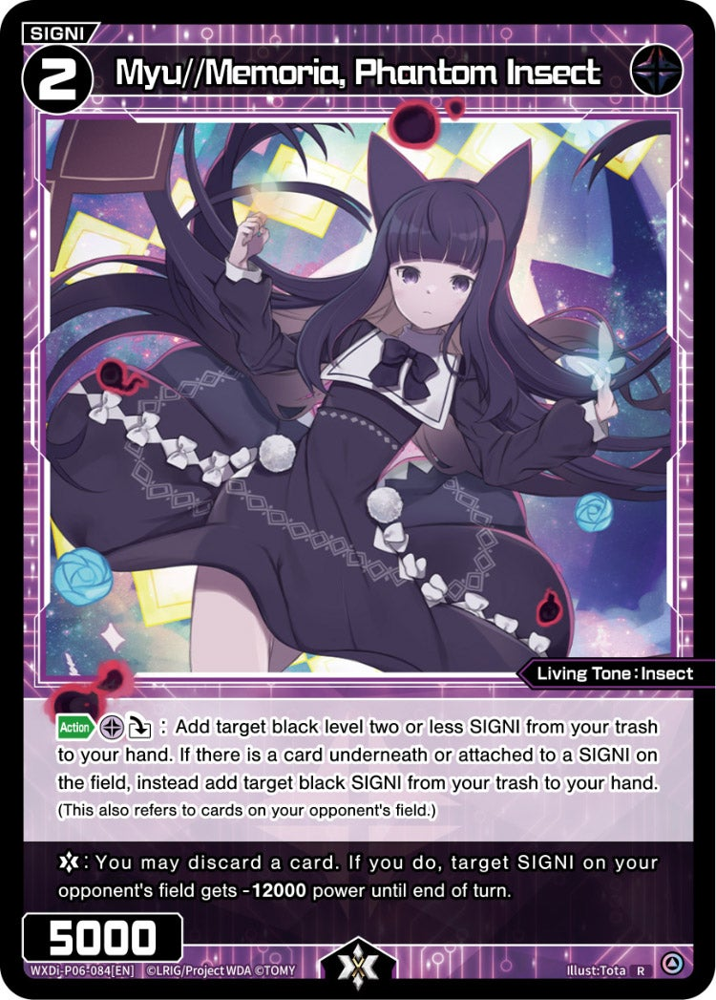

# Myu//Memoria, Phantom Insect

## Thông tin lá

| Trường | Giá trị |
| --- | --- |
| Mã in | WXDi-P06-084[EN] |
| Set | WXDi-P06[EN] |
| Số thứ tự | 084 |
| Loại thẻ | SIGNI |
| Vị trí | Main Deck |
| Số bản | — (set booster, không áp dụng) |
| Màu | Đen |
| Độ hiếm | R,R(P) |
| Minh họa | Tota
匡吉 |
| Level | 2 |
| Limit | — |
| Power | 5000 |
| LRIG type / Class | Living Tone：Insect |
| Team / Master | — |
| Cost | — |
| Grow cost | — |
| Use timing | — |
| Life Burst | Có |

## Card text chính thức

[Action] {Black} {Down}: Add target black level two or less SIGNI from your trash to your hand. If there is a card underneath or attached to a SIGNI on the field, instead add target black SIGNI from your trash to your hand. (This also refers to cards on your opponent's field.)

## Power text / Life Burst

You may discard a card. If you do, target SIGNI on your opponent's field gets -12000 power until end of turn.

## Ghi chú minh họa
Artist: Tota
匡吉. Ảnh R được tải từ Card List tiếng Anh.

## FAQ chính thức

**Q. What exactly is a "there is a card underneath or attached to a SIGNI?"**
A. A card attached to a SIGNI by an effect such as 【Soul】 becomes a card attached to a SIGNI. Also, a card underneath to a SIGNI by an effect such as 【Rise】 or 《Hyahha, Code: Accel》 becomes a card underneath to a SIGNI. Cards turned face down by the effect of 《Robin Hood, Jade General Queen》 or 【Hastalyk】 are not treated as cards placed under a SIGNI, even if they are physically unederneath to a SIGNI.

## Ảnh biến thể

- [R(P)](../images/WXDi-P06-084P-EN.jpg)

## Nguồn
[Card List/FAQ chính thức](https://www.takaratomy.co.jp/products/en.wixoss/card/card.html?card_no=WXDi-P06-084%5BEN%5D ) · [Ảnh thẻ](https://www.takaratomy.co.jp/products/en.wixoss/card/thumb/WXDi-P06-084%5BEN%5D.jpg)
