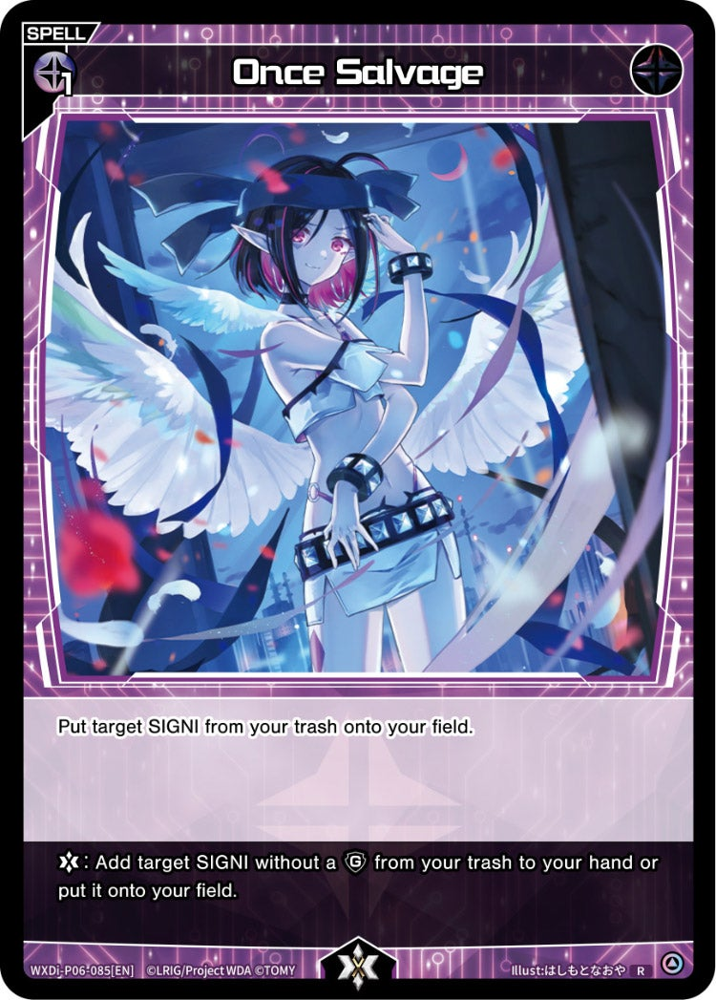

# Once Salvage

## Thông tin lá

| Trường | Giá trị |
| --- | --- |
| Mã in | WXDi-P06-085[EN] |
| Set | WXDi-P06[EN] |
| Số thứ tự | 085 |
| Loại thẻ | SPELL |
| Vị trí | Main Deck |
| Số bản | — (set booster, không áp dụng) |
| Màu | Đen |
| Độ hiếm | R,R(P) |
| Minh họa | はしもとなおや |
| Level | — |
| Limit | — |
| Power | 0 |
| LRIG type / Class | — |
| Team / Master | — |
| Cost | 《B》×１ |
| Grow cost | — |
| Use timing | — |
| Life Burst | Có |

## Card text chính thức

Put target SIGNI from your trash onto your field.

## Power text / Life Burst

Add target SIGNI without a {Guard Icon} from your trash to your hand or put it onto your field.

## Ghi chú minh họa
Artist: はしもとなおや. Ảnh R được tải từ Card List tiếng Anh.

## FAQ chính thức

**Q. May I use this spell to put a SIGNI from my trash over my LRIG's level or limit?**
A. No. If you put a SIGNI by this effect, you must also put it on the field in such a way that it does not exceed its level or limit. If you target a SIGNI that exceeds the LRIG's level or limit, the effect ends without any effect happening.

## Ảnh biến thể

- [R(P)](../images/WXDi-P06-085P-EN.jpg)

## Nguồn
[Card List/FAQ chính thức](https://www.takaratomy.co.jp/products/en.wixoss/card/card.html?card_no=WXDi-P06-085%5BEN%5D ) · [Ảnh thẻ](https://www.takaratomy.co.jp/products/en.wixoss/card/thumb/WXDi-P06-085%5BEN%5D.jpg)
