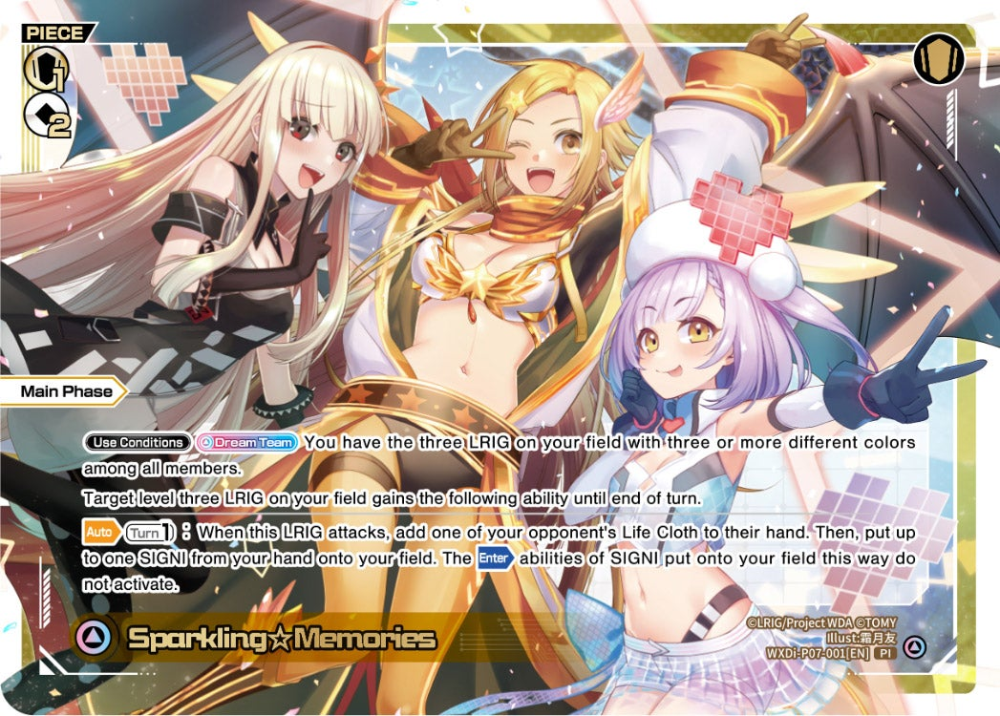

# Sparkling☆Memories

## Thông tin lá

| Trường | Giá trị |
| --- | --- |
| Mã in | WXDi-P07-001[EN] |
| Set | WXDi-P07[EN] |
| Số thứ tự | 001 |
| Loại thẻ | PIECE |
| Vị trí | LRIG Deck |
| Số bản | — (set booster, không áp dụng) |
| Màu | Trắng |
| Độ hiếm | PI,LRP |
| Minh họa | 霜月友 |
| Level | — |
| Limit | — |
| Power | 0 |
| LRIG type / Class | — |
| Team / Master | — |
| Cost | 《W》×１ / 《C》×２ |
| Grow cost | — |
| Use timing | Main Phase |
| Life Burst | Không |

## Card text chính thức

[Use Conditions] [Dream Team] You have the three LRIG on your field with three or more different colors among all members.

Target level three LRIG on your field gains the following ability until end of turn.
『[Auto] {1/Turn}: When this LRIG attacks, add one of your opponent's Life Cloth to their hand. Then, put up to one SIGNI from your hand onto your field. The [Enter] abilities of SIGNI put onto your field this way do not activate.』

## Power text / Life Burst

—

## Ghi chú minh họa
Artist: 霜月友. Ảnh PI được tải từ Card List tiếng Anh.

## FAQ chính thức

**Q. What is [Dream Team]?**
A. [Dream Team] is a PIECE that can be used if certain conditions listed there are met. Note that PIECE with [Dream Team] icon cannot be put in the LRIG deck together with PIECE with [Team] and [Dream Team] icons. (= total limit of one PIECE). For example, if you include one PIECE with [Dream Team] icon, you can only include another PIECE with neither icon.

**Q. The LRIG that gained the ability by this PIECE has attacked. Which effect resolve first: having the [Auto] ability "When this LRIG attacks" add one Life Cloth to thier hand, or crushing the Life Cloth by attack?**
A. Resolve the "When this LRIG attacks" [Auto] ability first. If it reduces your opponent's Life Cloth to zero and the attack is not [Guard] by your opponent, you win the game due to the damage of the LRIG attack.

**Q. As my opponent add one Life Cloth to thier hand by this [Auto] ability, I may look the surface of that Life Cloth?**
A. No, you cannot look the surface of that Life Cloth.

**Q. I put 《Mikagami, High Armed》 on my field by this [Auto] ability. Does "Whenever a LRIG on your field attacks" ability of 《Mikagami, High Armed》 trigger?**
A. No, it doesn't trigger. The [Auto] ability "Whenever a LRIG on your field attacks" of 《Mikagami, High Armed》 does not trigger unless 《Mikagami, High Armed》 is on your field when you declare your LRIG attack and the LRIG is down.

**Q. This [Auto] ability was triggered when my opponent has zero Life Cloth. May I put a SIGNI from my hand on my field?**
A. Yes, you can.

## Ảnh biến thể

- [LRP](../images/WXDi-P07-001P-EN.jpg)

## Nguồn
[Card List/FAQ chính thức](https://www.takaratomy.co.jp/products/en.wixoss/card/card.html?card_no=WXDi-P07-001%5BEN%5D ) · [Ảnh thẻ](https://www.takaratomy.co.jp/products/en.wixoss/card/thumb/WXDi-P07-001%5BEN%5D.jpg)
