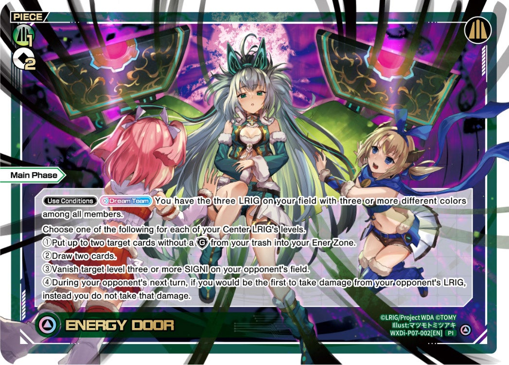

# ENERGY DOOR

## Thông tin lá

| Trường | Giá trị |
| --- | --- |
| Mã in | WXDi-P07-002[EN] |
| Set | WXDi-P07[EN] |
| Số thứ tự | 002 |
| Loại thẻ | PIECE |
| Vị trí | LRIG Deck |
| Số bản | — (set booster, không áp dụng) |
| Màu | Xanh lá |
| Độ hiếm | PI,LRP |
| Minh họa | マツモトミツアキ |
| Level | — |
| Limit | — |
| Power | 0 |
| LRIG type / Class | — |
| Team / Master | — |
| Cost | 《G》×１
《C》×２ |
| Grow cost | — |
| Use timing | Main Phase |
| Life Burst | Không |

## Card text chính thức

[Use Conditions] [Dream Team] You have the three LRIG on your field with three or more different colors among all members.

Choose one of the following for each of your Center LRIG's levels.
①Put up to two target cards without a {Guard Icon} from your trash into your Ener Zone.
②Draw two cards.
③Vanish target level three or more SIGNI on your opponent's field.
④During your opponent's next turn, if you would be the first to take damage from your opponent's LRIG, instead you do not take that damage.

## Power text / Life Burst

—

## Ghi chú minh họa
Artist: マツモトミツアキ. Ảnh PI được tải từ Card List tiếng Anh.

## FAQ chính thức

**Q. What is [Dream Team]?**
A. [Dream Team] is a PIECE that can be used if certain conditions listed there are met. Note that PIECE with [Dream Team] icon cannot be put in the LRIG deck together with PIECE with [Team] and [Dream Team] icons. (= total limit of one PIECE). For example, if you include one PIECE with [Dream Team] icon, you can only include another PIECE with neither icon.

**Q. If my center LRIG is level five, may I choose four options and then any one more?**
A. No, you cannot. Unless otherwise stated, the same option cannot be chosen, so the maximum number of options is four ① to ④.

**Q. If I choose ①. May I put cards that paid for as the Ener cost of this PIECE into my Ener Zone?**
A. Yes, you can put a card if meets the condition. After paying the Ener cost of this PIECE and put them into your trash, target cards in your trash.

**Q. When my opponent's LRIG with 【Double Crush】  attacked after I choose ④, How many my Life Cloth are crushed by that attacks?**
A. Zero cards. 【Double Crush】 is the ability to crush two Life Cloth when crushing Life Cloth due to damage, and not a single one if the damage itself is not taken, as in the case of this PIECE.

**Q. I choose ② and ③ to use this PIECE. May I draw two cards and look them by option ②, then vanish target a SIGNI by option ③?**
A. No, you cannot. After choosing the options, choose the required targets for those options before you start resolving the effects. If you choose ② and ③, choose the target SIGNI to vanish with ③, then draw two cards with ② and vanish target SIGNI with ③.

## Ảnh biến thể

- [LRP](../images/WXDi-P07-002P-EN.jpg)

## Nguồn
[Card List/FAQ chính thức](https://www.takaratomy.co.jp/products/en.wixoss/card/card.html?card_no=WXDi-P07-002%5BEN%5D ) · [Ảnh thẻ](https://www.takaratomy.co.jp/products/en.wixoss/card/thumb/WXDi-P07-002%5BEN%5D.jpg)
