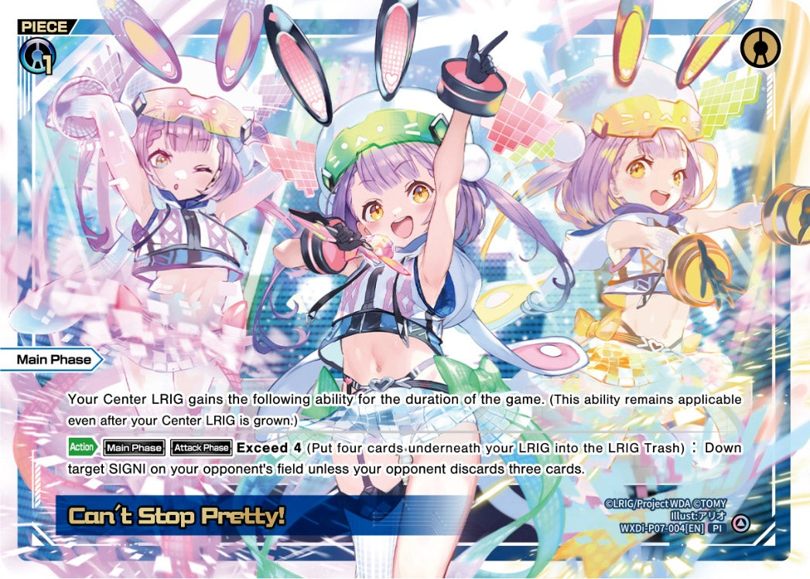

# Can't Stop Pretty!

## Thông tin lá

| Trường | Giá trị |
| --- | --- |
| Mã in | WXDi-P07-004[EN] |
| Set | WXDi-P07[EN] |
| Số thứ tự | 004 |
| Loại thẻ | PIECE |
| Vị trí | LRIG Deck |
| Số bản | — (set booster, không áp dụng) |
| Màu | Xanh dương |
| Độ hiếm | PI,LRP |
| Minh họa | アリオ |
| Level | — |
| Limit | — |
| Power | 0 |
| LRIG type / Class | — |
| Team / Master | — |
| Cost | 《U》×１ |
| Grow cost | — |
| Use timing | Main Phase |
| Life Burst | Không |

## Card text chính thức

Your Center LRIG gains the following ability for the duration of the game. (This ability remains applicable even after your Center LRIG is grown.)
『[Action] {Main Phase Icon} {Attack Phase Icon} Exceed 4 (Put four cards underneath your LRIG into the LRIG Trash): Down target SIGNI on your opponent's field unless your opponent discards three cards.』

## Power text / Life Burst

—

## Ghi chú minh họa
Artist: アリオ. Ảnh PI được tải từ Card List tiếng Anh.

## FAQ chính thức

— (không có FAQ riêng cho mã này trên trang FAQ tiếng Anh.)

## Ảnh biến thể

- [LRP](../images/WXDi-P07-004P-EN.jpg)

## Nguồn
[Card List/FAQ chính thức](https://www.takaratomy.co.jp/products/en.wixoss/card/card.html?card_no=WXDi-P07-004%5BEN%5D ) · [Ảnh thẻ](https://www.takaratomy.co.jp/products/en.wixoss/card/thumb/WXDi-P07-004%5BEN%5D.jpg)
