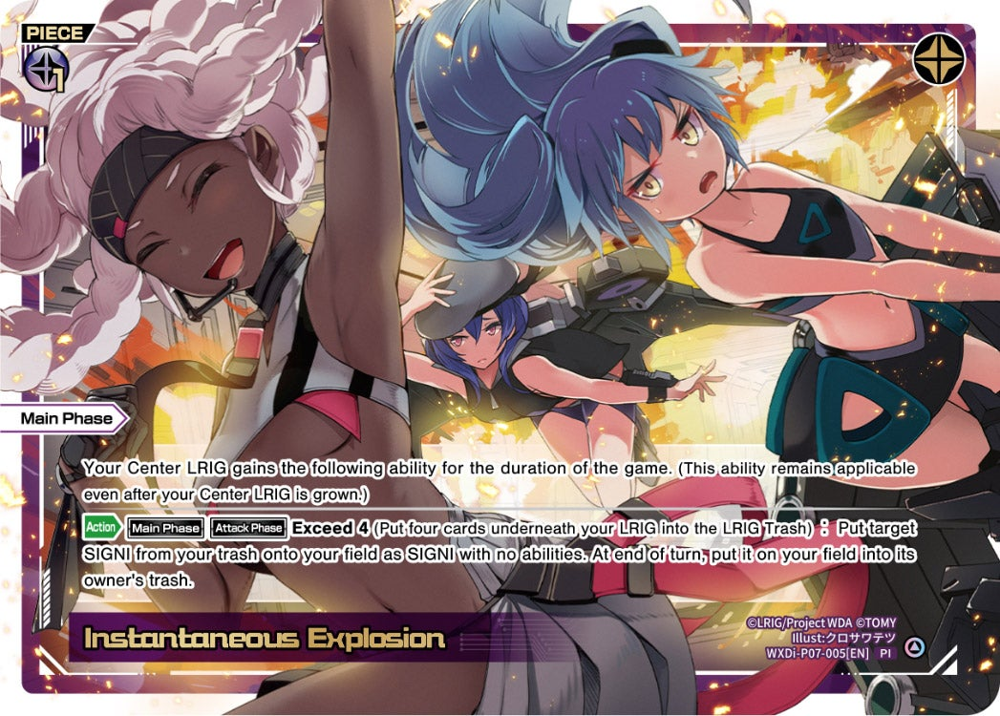

# Instantaneous Explosion

## Thông tin lá

| Trường | Giá trị |
| --- | --- |
| Mã in | WXDi-P07-005[EN] |
| Set | WXDi-P07[EN] |
| Số thứ tự | 005 |
| Loại thẻ | PIECE |
| Vị trí | LRIG Deck |
| Số bản | — (set booster, không áp dụng) |
| Màu | Đen |
| Độ hiếm | PI,LRP |
| Minh họa | クロサワテツ |
| Level | — |
| Limit | — |
| Power | 0 |
| LRIG type / Class | — |
| Team / Master | — |
| Cost | 《B》×１ |
| Grow cost | — |
| Use timing | Main Phase |
| Life Burst | Không |

## Card text chính thức

Your Center LRIG gains the following ability for the duration of the game. (This ability remains applicable even after your Center LRIG is grown.)
『[Action] {Main Phase Icon} {Attack Phase Icon} Exceed 4 (Put four cards underneath your LRIG into the LRIG Trash): Put target SIGNI from your trash onto your field as SIGNI with no abilities. Put this SIGNI on your field into its owner's trash at the end of turn.』

## Power text / Life Burst

—

## Ghi chú minh họa
Artist: クロサワテツ. Ảnh PI được tải từ Card List tiếng Anh.

## FAQ chính thức

**Q. I put a SIGNI on my field by Exceed ability of this PIECE, then it was vanished and put it into my Ener Zone. Do I put it into my trash from my Ener Zone at the end of turn?**
A. No. If the SIGNI is moved from the field to another zone, your don't need put it into your trash.

**Q. I put a SIGNI on my field by Exceed ability of this PIECE, then I placed a SIGNI with 【Rise】 on top of it on my field. Does the SIGNI underneath the 【Rise】 SIGNI put into the trash at the end of the turn?**
A. No, the SIGNI underneath the 【Rise】 SIGNI not put into your trash at the end of turn. It will remain placed under the 【Rise】 SIGNI.

## Ảnh biến thể

- [LRP](../images/WXDi-P07-005P-EN.jpg)

## Nguồn
[Card List/FAQ chính thức](https://www.takaratomy.co.jp/products/en.wixoss/card/card.html?card_no=WXDi-P07-005%5BEN%5D ) · [Ảnh thẻ](https://www.takaratomy.co.jp/products/en.wixoss/card/thumb/WXDi-P07-005%5BEN%5D.jpg)
