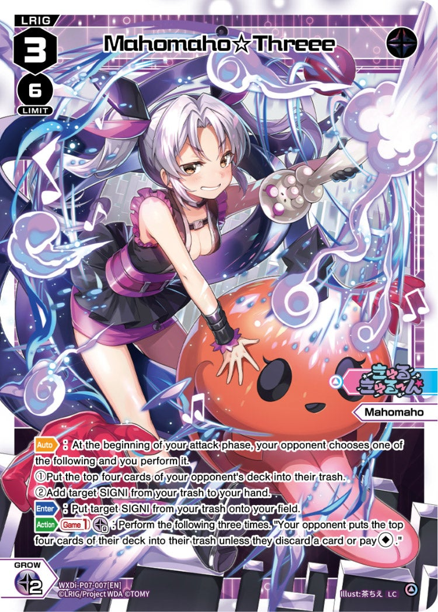

# Mahomaho☆Threee

## Thông tin lá

| Trường | Giá trị |
| --- | --- |
| Mã in | WXDi-P07-007[EN] |
| Set | WXDi-P07[EN] |
| Số thứ tự | 007 |
| Loại thẻ | LRIG |
| Vị trí | LRIG Deck |
| Số bản | — (set booster, không áp dụng) |
| Màu | Đen |
| Độ hiếm | LC,LR,LRP,UR |
| Minh họa | 茶ちえ |
| Level | 3 |
| Limit | 6 |
| Power | 0 |
| LRIG type / Class | Mahomaho |
| Team / Master | Kyurukyurun☆ |
| Cost | — |
| Grow cost | 《B》×２ |
| Use timing | — |
| Life Burst | Không |

## Card text chính thức

[Auto]: At the beginning of your attack phase, your opponent chooses one of the following and you perform it.
①Put the top four cards of your opponent's deck into their trash.
②Add target SIGNI from your trash to your hand.
[Enter]: Put target SIGNI from your trash onto your field.
[Action] {1/Game} {Blackx0}: Perform the following three times. "Your opponent puts the top four cards of their deck into their trash unless they discard a card or pay {Colorless}."

## Power text / Life Burst

—

## Ghi chú minh họa
Artist: 茶ちえ. Ảnh LC được tải từ Card List tiếng Anh.

## FAQ chính thức

**Q. Which player target SIGNI in my trash by the [Auto] ability?**
A. You can target SIGNI. ( The player who controls 《Mahomaho☆Threee》.)

**Q. What happens if there are four or less cards in my opponent's deck when I used this [Action] ability?**
A. If your opponent put four cards from the top of the deck into thier owner's trash in the first of three effects, your opponent will have zero cards in your opponent's deck. Refresh by Rule-based action is not performed during the effect, so the remaining two effects are dealt with first. Both effects can choose to put cards from the top of your opponent's deck into thier owners trash, in which case nothing happens. Once all effects have been resolved, your opponent performs refresh deck.

**Q. Do I have to put a SIGNI from my trash by the [Enter] ability?**
A. You must trigger the [Enter] ability if it is not need to pay cost. But if you need put a SIGNI by this effect, it cannot be put to exceed the level or total limit, so it is possible to target such a SIGNI and consequently not put it on the field.

## Ảnh biến thể

- [LRP](../images/WXDi-P07-007P-EN.jpg)
- [LR](../images/WXDi-P07-007R-EN.jpg)
- [UR](../images/WXDi-P07-007U-EN.jpg)

## Nguồn
[Card List/FAQ chính thức](https://www.takaratomy.co.jp/products/en.wixoss/card/card.html?card_no=WXDi-P07-007%5BEN%5D ) · [Ảnh thẻ](https://www.takaratomy.co.jp/products/en.wixoss/card/thumb/WXDi-P07-007%5BEN%5D.jpg)
