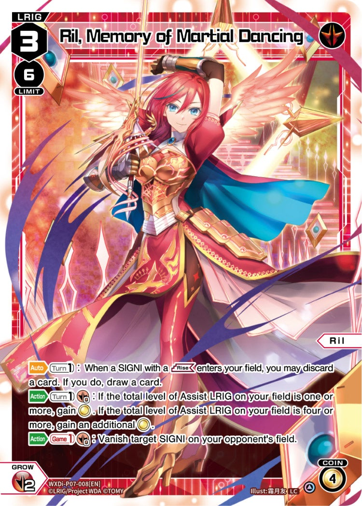

# Ril, Memory of Martial Dancing

## Thông tin lá

| Trường | Giá trị |
| --- | --- |
| Mã in | WXDi-P07-008[EN] |
| Set | WXDi-P07[EN] |
| Số thứ tự | 008 |
| Loại thẻ | LRIG |
| Vị trí | LRIG Deck |
| Số bản | — (set booster, không áp dụng) |
| Màu | Đỏ |
| Độ hiếm | LC,LR,LRP,UR |
| Minh họa | 霜月友 / Hitoto* |
| Level | 3 |
| Limit | 6 |
| Power | 0 |
| LRIG type / Class | Ril |
| Team / Master | — |
| Cost | — |
| Grow cost | 《R》×２ |
| Use timing | — |
| Life Burst | Không |

## Card text chính thức

[Auto] {1/Turn}: When a SIGNI with a {Rise Icon} enters your field, you may discard a card. If you do, draw a card.
[Action] {1/Turn} {Redx0}: If the total level of Assist LRIG on your field is one or more, gain {Coin Icon}. If the total level of Assist LRIG on your field is four or more, gain an additional {Coin Icon}.
[Action] {1/Game} {Redx0}: Vanish target SIGNI on your opponent's field.

## Power text / Life Burst

—

## Ghi chú minh họa
Artist: 霜月友 / Hitoto*. Ảnh LC được tải từ Card List tiếng Anh.

## FAQ chính thức

**Q. I used the first [Action] ability when I have four coins. If the total level of the assist LRIG on my field is four or more, how many coins do I gain?**
A. You gain one coin. Originally, you gain two coins because you fulfil the conditions, but because the maximum number of coins you can hold is five, you gain one and the number of coins becomes five.

## Ảnh biến thể

- [LRP](../images/WXDi-P07-008P-EN.jpg)
- [LR](../images/WXDi-P07-008R-EN.jpg)
- [UR](../images/WXDi-P07-008U-EN.jpg)

## Nguồn
[Card List/FAQ chính thức](https://www.takaratomy.co.jp/products/en.wixoss/card/card.html?card_no=WXDi-P07-008%5BEN%5D ) · [Ảnh thẻ](https://www.takaratomy.co.jp/products/en.wixoss/card/thumb/WXDi-P07-008%5BEN%5D.jpg)
