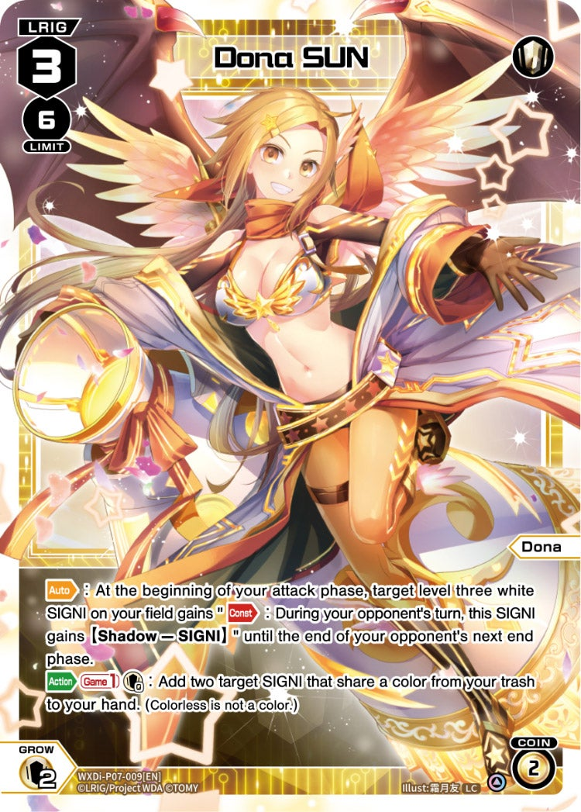

# Dona SUN

## Thông tin lá

| Trường | Giá trị |
| --- | --- |
| Mã in | WXDi-P07-009[EN] |
| Set | WXDi-P07[EN] |
| Số thứ tự | 009 |
| Loại thẻ | LRIG |
| Vị trí | LRIG Deck |
| Số bản | — (set booster, không áp dụng) |
| Màu | Trắng |
| Độ hiếm | LC,LR,LRP,UR |
| Minh họa | 霜月友
mado*pen |
| Level | 3 |
| Limit | 6 |
| Power | 0 |
| LRIG type / Class | Dona |
| Team / Master | — |
| Cost | — |
| Grow cost | 《W》×２ |
| Use timing | 2 |
| Life Burst | Không |

## Card text chính thức

[Auto]: At the beginning of your attack phase, target level three white SIGNI on your field gains "[Constant]: During your opponent's turn, this SIGNI gains 【Shadow — SIGNI】" until the end of your opponent's next end phase.
[Action] {1/Game} {Whitex0}: Add two target SIGNI that share a color from your trash to your hand. (Colorless is not a color.)

## Power text / Life Burst

—

## Ghi chú minh họa
Artist: 霜月友
mado*pen. Ảnh LC được tải từ Card List tiếng Anh.

## FAQ chính thức

— (không có FAQ riêng cho mã này trên trang FAQ tiếng Anh.)

## Ảnh biến thể

- [LRP](../images/WXDi-P07-009P-EN.jpg)
- [LR](../images/WXDi-P07-009R-EN.jpg)
- [UR](../images/WXDi-P07-009U-EN.jpg)

## Nguồn
[Card List/FAQ chính thức](https://www.takaratomy.co.jp/products/en.wixoss/card/card.html?card_no=WXDi-P07-009%5BEN%5D ) · [Ảnh thẻ](https://www.takaratomy.co.jp/products/en.wixoss/card/thumb/WXDi-P07-009%5BEN%5D.jpg)
