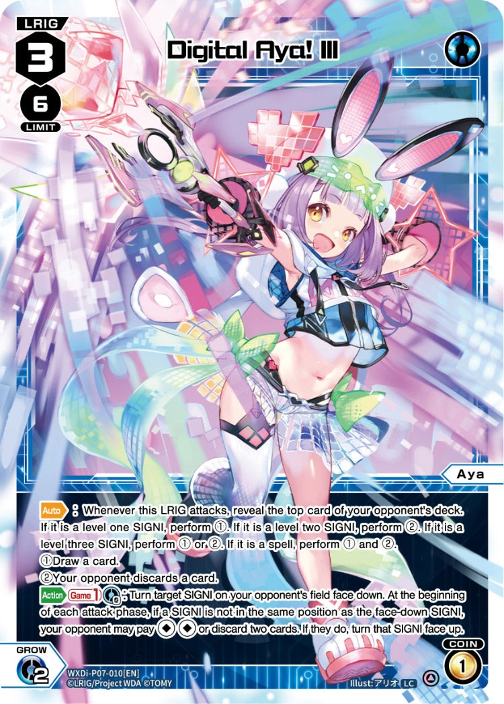

# Digital Aya! III

## Thông tin lá

| Trường | Giá trị |
| --- | --- |
| Mã in | WXDi-P07-010[EN] |
| Set | WXDi-P07[EN] |
| Số thứ tự | 010 |
| Loại thẻ | LRIG |
| Vị trí | LRIG Deck |
| Số bản | — (set booster, không áp dụng) |
| Màu | Xanh dương |
| Độ hiếm | LC,LR,LRP,UR |
| Minh họa | アリオ
アカバネ |
| Level | 3 |
| Limit | 6 |
| Power | 0 |
| LRIG type / Class | Aya |
| Team / Master | — |
| Cost | — |
| Grow cost | 《U》×２ |
| Use timing | 1 |
| Life Burst | Không |

## Card text chính thức

[Auto]: Whenever this LRIG attacks, reveal the top card of your opponent's deck. If it is a level one SIGNI, perform ①. If it is a level two SIGNI, perform ②. If it is a level three SIGNI, perform ① or ②. If it is a spell, perform ① and ②.
①Draw a card.
②Your opponent discards a card.
[Action] {1/Game} {Bluex0}: Turn target SIGNI on your opponent's field face down. At the beginning of each attack phase, if a SIGNI is not in the same position as the face-down SIGNI, your opponent may pay {Colorless} {Colorless} or discard two cards. If they do, turn that SIGNI face up.

## Power text / Life Burst

—

## Ghi chú minh họa
Artist: アリオ
アカバネ. Ảnh LC được tải từ Card List tiếng Anh.

## FAQ chính thức

**Q. What happens to the top card of my opponent's deck that is revealed by the [Auto] ability?**
A. After processing the effects ① and/or ② according to the revealed card, turn it face down and return it to the top of your opponent's deck.

**Q. In the Attack Phase after using this [Action] ability, my opponent chooses to leave the SIGNI face-down without paying anything. What happens to that face-down card?**
A. A face-down SIGNI remains in the SIGNI Zone face-down, and furthermore, at the beginning of the next Attack Phase, the ability to pay the cost to turn it face-up or not is triggered.

## Ảnh biến thể

- [LRP](../images/WXDi-P07-010P-EN.jpg)
- [LR](../images/WXDi-P07-010R-EN.jpg)
- [UR](../images/WXDi-P07-010U-EN.jpg)

## Nguồn
[Card List/FAQ chính thức](https://www.takaratomy.co.jp/products/en.wixoss/card/card.html?card_no=WXDi-P07-010%5BEN%5D ) · [Ảnh thẻ](https://www.takaratomy.co.jp/products/en.wixoss/card/thumb/WXDi-P07-010%5BEN%5D.jpg)
