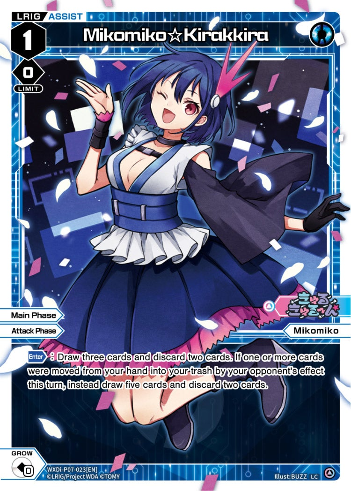

# Mikomiko☆Kirakkira

## Thông tin lá

| Trường | Giá trị |
| --- | --- |
| Mã in | WXDi-P07-023[EN] |
| Set | WXDi-P07[EN] |
| Số thứ tự | 023 |
| Loại thẻ | ASSIST LRIG |
| Vị trí | LRIG Deck |
| Số bản | — (set booster, không áp dụng) |
| Màu | Xanh dương |
| Độ hiếm | LC,LC(P) |
| Minh họa | BUZZ |
| Level | 1 |
| Limit | 0 |
| Power | 0 |
| LRIG type / Class | Mikomiko |
| Team / Master | Kyurukyurun☆ |
| Cost | — |
| Grow cost | 《C》×０ |
| Use timing | Main Phase / Attack Phase |
| Life Burst | Không |

## Card text chính thức

[Enter]: Draw three cards and discard two cards. If one or more cards were moved from your hand into your trash by your opponent's effect this turn, instead draw five cards and discard two cards.

## Power text / Life Burst

—

## Ghi chú minh họa
Artist: BUZZ. Ảnh LC được tải từ Card List tiếng Anh.

## FAQ chính thức

**Q. What happens if my deck is smaller than the number of cards drawn by this [Enter] ability?**
A. If so, draw all the cards in your deck and discard two cards from your hand. If you have only one card in your hand when you discard cards, discard it. Afterwards, refresh your deck as there are zero cards in it.

## Ảnh biến thể

- [LC(P)](../images/WXDi-P07-023P-EN.jpg)

## Nguồn
[Card List/FAQ chính thức](https://www.takaratomy.co.jp/products/en.wixoss/card/card.html?card_no=WXDi-P07-023%5BEN%5D ) · [Ảnh thẻ](https://www.takaratomy.co.jp/products/en.wixoss/card/thumb/WXDi-P07-023%5BEN%5D.jpg)
