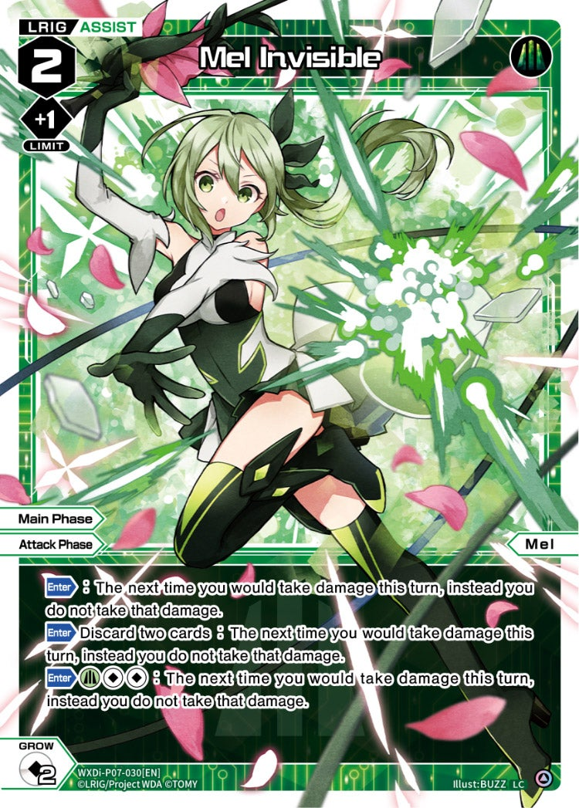

# Mel Invisible

## Thông tin lá

| Trường | Giá trị |
| --- | --- |
| Mã in | WXDi-P07-030[EN] |
| Set | WXDi-P07[EN] |
| Số thứ tự | 030 |
| Loại thẻ | ASSIST LRIG |
| Vị trí | LRIG Deck |
| Số bản | — (set booster, không áp dụng) |
| Màu | Xanh lá |
| Độ hiếm | LC,LC(P) |
| Minh họa | BUZZ |
| Level | 2 |
| Limit | ＋１ |
| Power | 0 |
| LRIG type / Class | Mel |
| Team / Master | — |
| Cost | — |
| Grow cost | 《C》×２ |
| Use timing | Main Phase / Attack Phase |
| Life Burst | Không |

## Card text chính thức

[Enter]: The next time you would take damage this turn, instead you do not take that damage.
[Enter] Discard two cards: The next time you would take damage this turn, instead you do not take that damage.
[Enter] {Green} {Colorless} {Colorless}: The next time you would take damage this turn, instead you do not take that damage.

## Power text / Life Burst

—

## Ghi chú minh họa
Artist: BUZZ. Ảnh LC được tải từ Card List tiếng Anh.

## FAQ chính thức

**Q. What happens if this card is triggered all [Enter] abilities?**
A. This turn, you will not be damaged for the next three times.

**Q. When my opponent's SIGNI with 【Double Crush】  attacked after this [Enter] ability was resolved , How many my Life Cloth are crushed by that attacks?**
A. Zero cards. 【Double Crush】 is the ability to crush two Life Cloth when crushing Life Cloth due to damage, and not a single one if the damage itself is not taken.

**Q. If this [Enter] ability is resolved. May I prevent the effect of "crush one of your opponent's Life Cloth."?**
A. No, you cannot. You cannot prevent an effect that does not deal damage but "crush one of your opponent's Life Cloth.". You can prevent effects that "deal damage."

## Ảnh biến thể

- [LC(P)](../images/WXDi-P07-030P-EN.jpg)

## Nguồn
[Card List/FAQ chính thức](https://www.takaratomy.co.jp/products/en.wixoss/card/card.html?card_no=WXDi-P07-030%5BEN%5D ) · [Ảnh thẻ](https://www.takaratomy.co.jp/products/en.wixoss/card/thumb/WXDi-P07-030%5BEN%5D.jpg)
