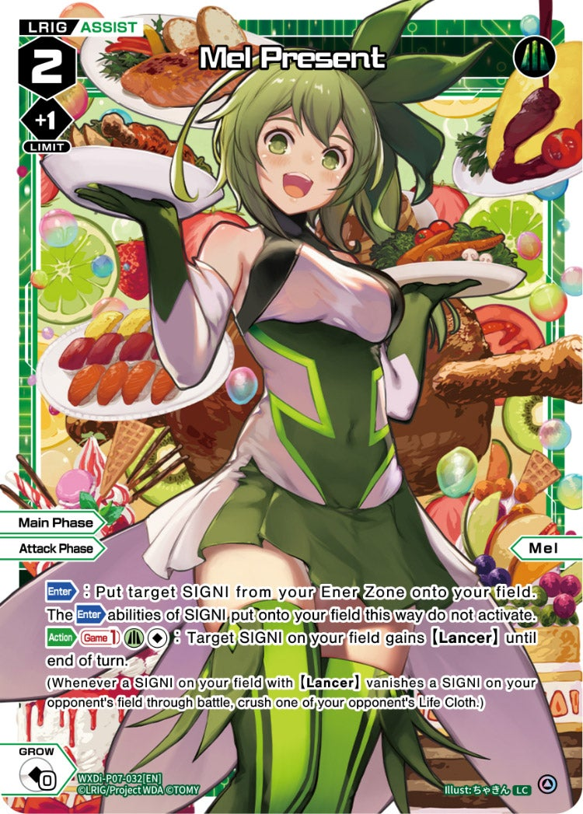

# Mel Present

## Thông tin lá

| Trường | Giá trị |
| --- | --- |
| Mã in | WXDi-P07-032[EN] |
| Set | WXDi-P07[EN] |
| Số thứ tự | 032 |
| Loại thẻ | ASSIST LRIG |
| Vị trí | LRIG Deck |
| Số bản | — (set booster, không áp dụng) |
| Màu | Xanh lá |
| Độ hiếm | LC,LC(P) |
| Minh họa | ちゃきん |
| Level | 2 |
| Limit | ＋１ |
| Power | 0 |
| LRIG type / Class | Mel |
| Team / Master | — |
| Cost | — |
| Grow cost | 《C》×０ |
| Use timing | Main Phase / Attack Phase |
| Life Burst | Không |

## Card text chính thức

[Enter]: Put target SIGNI from your Ener Zone onto your field. The [Enter] abilities of SIGNI put onto your field this way do not activate.
[Action] {1/Game} {Green} {Colorless}: Target SIGNI on your field gains 【Lancer】 until end of turn.
(Whenever a SIGNI on your field with 【Lancer】 vanishes a SIGNI on your opponent's field through battle, crush one of your opponent's Life Cloth.)

## Power text / Life Burst

—

## Ghi chú minh họa
Artist: ちゃきん. Ảnh LC được tải từ Card List tiếng Anh.

## FAQ chính thức

**Q. Does the [Enter] ability must trigger?**
A. Yes, you must trigger the [Enter] ability if it is not need to pay cost. But if you need put a SIGNI by this effect, it cannot be put to exceed the level or total limit, so it is possible to target such a SIGNI and consequently not put it on the field.

## Ảnh biến thể

- [LC(P)](../images/WXDi-P07-032P-EN.jpg)

## Nguồn
[Card List/FAQ chính thức](https://www.takaratomy.co.jp/products/en.wixoss/card/card.html?card_no=WXDi-P07-032%5BEN%5D ) · [Ảnh thẻ](https://www.takaratomy.co.jp/products/en.wixoss/card/thumb/WXDi-P07-032%5BEN%5D.jpg)
