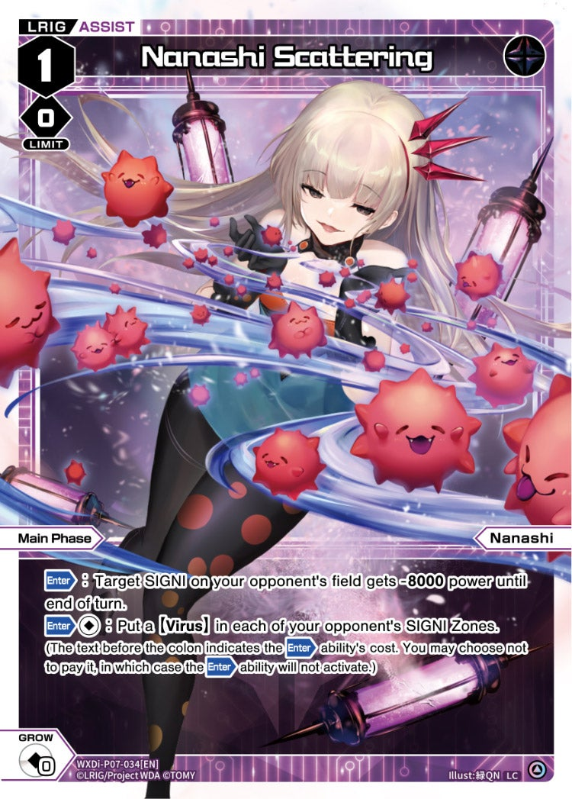

# Nanashi Scattering

## Thông tin lá

| Trường | Giá trị |
| --- | --- |
| Mã in | WXDi-P07-034[EN] |
| Set | WXDi-P07[EN] |
| Số thứ tự | 034 |
| Loại thẻ | ASSIST LRIG |
| Vị trí | LRIG Deck |
| Số bản | — (set booster, không áp dụng) |
| Màu | Đen |
| Độ hiếm | LC,LC(P) |
| Minh họa | 緑QN |
| Level | 1 |
| Limit | 0 |
| Power | 0 |
| LRIG type / Class | Nanashi |
| Team / Master | — |
| Cost | — |
| Grow cost | 《C》×０ |
| Use timing | Main Phase |
| Life Burst | Không |

## Card text chính thức

[Enter]: Target SIGNI on your opponent's field gets -8000 power until end of turn.
[Enter] {Colorless}: Put a 【Virus】 in each of your opponent's SIGNI Zones.
(The text before the colon indicates the [Enter] ability's cost. You may choose not to pay it, in which case the [Enter] ability will not activate.)

## Power text / Life Burst

—

## Ghi chú minh họa
Artist: 緑QN. Ảnh LC được tải từ Card List tiếng Anh.

## FAQ chính thức

**Q. What is 【Virus】?**
A. A card effect may put 【Virus】 on the SIGNI Zone. You can put up to one 【Virus】 per SIGNI Zone.
The SIGNI in the same Signi Zone as 【Virus】 become infected. Nothing happens just by being infected, but the effect may refer to the infected state.

## Ảnh biến thể

- [LC(P)](../images/WXDi-P07-034P-EN.jpg)

## Nguồn
[Card List/FAQ chính thức](https://www.takaratomy.co.jp/products/en.wixoss/card/card.html?card_no=WXDi-P07-034%5BEN%5D ) · [Ảnh thẻ](https://www.takaratomy.co.jp/products/en.wixoss/card/thumb/WXDi-P07-034%5BEN%5D.jpg)
