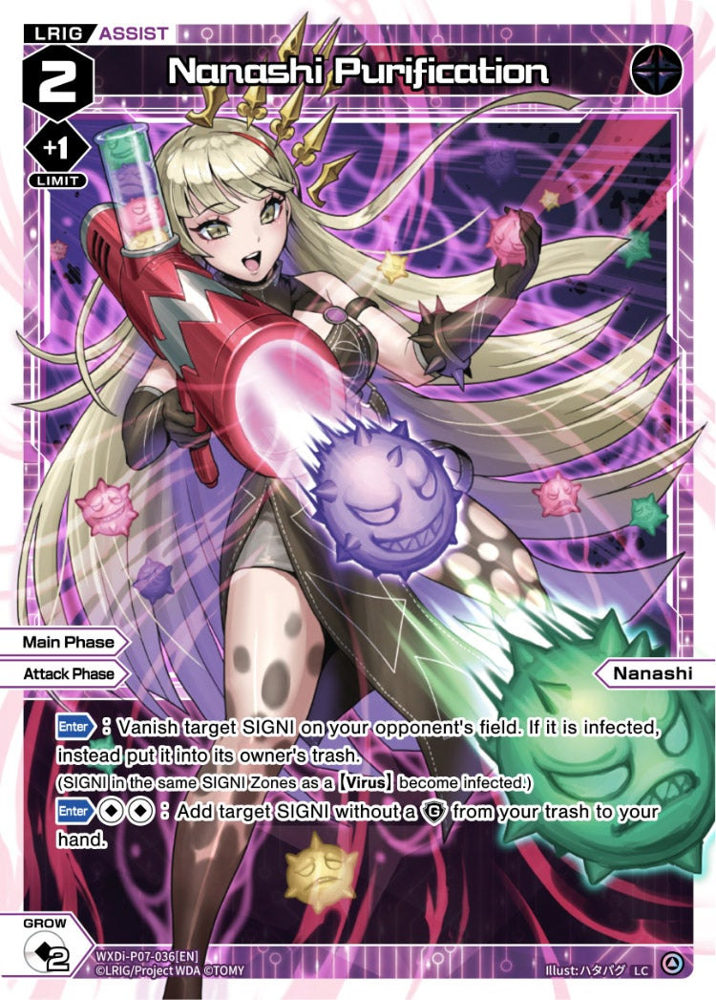

# Nanashi Purification

## Thông tin lá

| Trường | Giá trị |
| --- | --- |
| Mã in | WXDi-P07-036[EN] |
| Set | WXDi-P07[EN] |
| Số thứ tự | 036 |
| Loại thẻ | ASSIST LRIG |
| Vị trí | LRIG Deck |
| Số bản | — (set booster, không áp dụng) |
| Màu | Đen |
| Độ hiếm | LC,LC(P) |
| Minh họa | ハタパグ |
| Level | 2 |
| Limit | ＋１ |
| Power | 0 |
| LRIG type / Class | Nanashi |
| Team / Master | — |
| Cost | — |
| Grow cost | 《C》×２ |
| Use timing | Main Phase / Attack Phase |
| Life Burst | Không |

## Card text chính thức

[Enter]: Vanish target SIGNI on your opponent's field. If it is infected, instead put it into its owner's trash.
(SIGNI in the same SIGNI Zones as a 【Virus】 become infected.)
[Enter] {Colorless} {Colorless}: Add target SIGNI without a {Guard Icon} from your trash to your hand.

## Power text / Life Burst

—

## Ghi chú minh họa
Artist: ハタパグ. Ảnh LC được tải từ Card List tiếng Anh.

## FAQ chính thức

**Q. May a SIGNI with the "cannot be vanished" ability be put it into my opponent's trash with the first [Enter] ability if it is Infected?**
A. Yes, you can. If the SIGNI is Infected, this effect becomes "put target SIGNI on your opponent's field into its owner's trash.".

**Q. What is 【Virus】?**
A. A card effect may put 【Virus】 on the SIGNI Zone. You can put up to one 【Virus】 per SIGNI Zone.
The SIGNI in the same Signi Zone as 【Virus】 become infected. Nothing happens just by being infected, but the effect may refer to the infected state.

## Ảnh biến thể

- [LC(P)](../images/WXDi-P07-036P-EN.jpg)

## Nguồn
[Card List/FAQ chính thức](https://www.takaratomy.co.jp/products/en.wixoss/card/card.html?card_no=WXDi-P07-036%5BEN%5D ) · [Ảnh thẻ](https://www.takaratomy.co.jp/products/en.wixoss/card/thumb/WXDi-P07-036%5BEN%5D.jpg)
