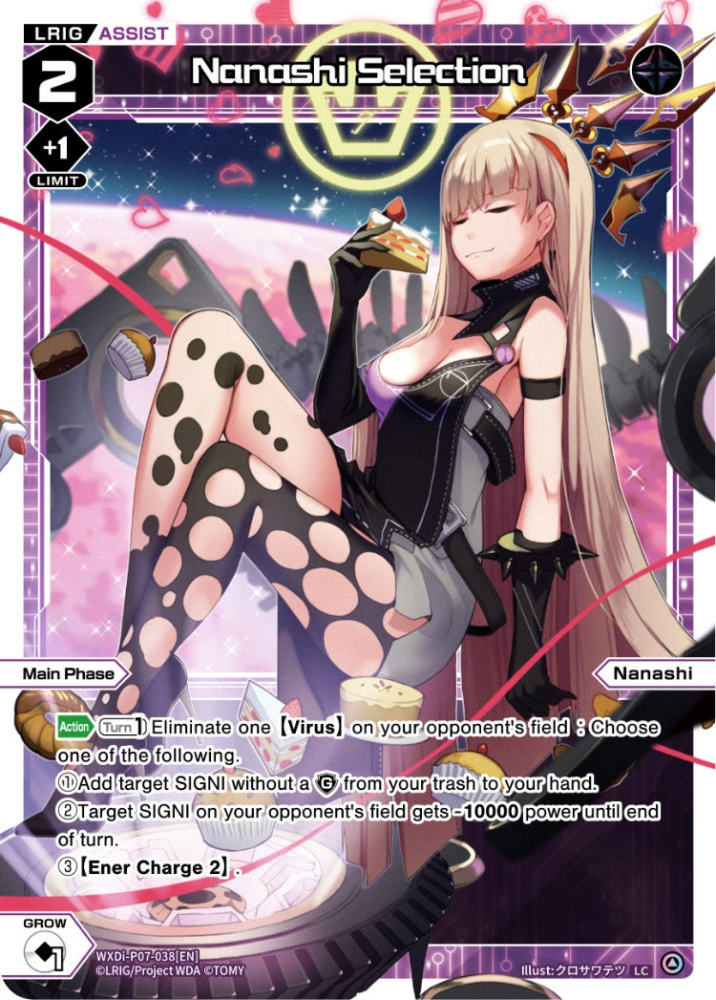

# Nanashi Selection

## Thông tin lá

| Trường | Giá trị |
| --- | --- |
| Mã in | WXDi-P07-038[EN] |
| Set | WXDi-P07[EN] |
| Số thứ tự | 038 |
| Loại thẻ | ASSIST LRIG |
| Vị trí | LRIG Deck |
| Số bản | — (set booster, không áp dụng) |
| Màu | Đen |
| Độ hiếm | LC,LC(P) |
| Minh họa | クロサワテツ |
| Level | 2 |
| Limit | ＋１ |
| Power | 0 |
| LRIG type / Class | Nanashi |
| Team / Master | — |
| Cost | — |
| Grow cost | 《C》×１ |
| Use timing | Main Phase |
| Life Burst | Không |

## Card text chính thức

[Action] {1/Turn} Eliminate one 【Virus】 on your opponent's field: Choose one of the following.
①Add target SIGNI without a {Guard Icon} from your trash to your hand.
②Target SIGNI on your opponent's field gets -10000 power until end of turn.
③【Ener Charge 2】.

## Power text / Life Burst

—

## Ghi chú minh họa
Artist: クロサワテツ. Ảnh LC được tải từ Card List tiếng Anh.

## FAQ chính thức

**Q. What is 【Virus】?**
A. A card effect may put 【Virus】 on the SIGNI Zone. You can put up to one 【Virus】 per SIGNI Zone.
The SIGNI in the same Signi Zone as 【Virus】 become infected. Nothing happens just by being infected, but the effect may refer to the infected state.

## Ảnh biến thể

- [LC(P)](../images/WXDi-P07-038P-EN.jpg)

## Nguồn
[Card List/FAQ chính thức](https://www.takaratomy.co.jp/products/en.wixoss/card/card.html?card_no=WXDi-P07-038%5BEN%5D ) · [Ảnh thẻ](https://www.takaratomy.co.jp/products/en.wixoss/card/thumb/WXDi-P07-038%5BEN%5D.jpg)
