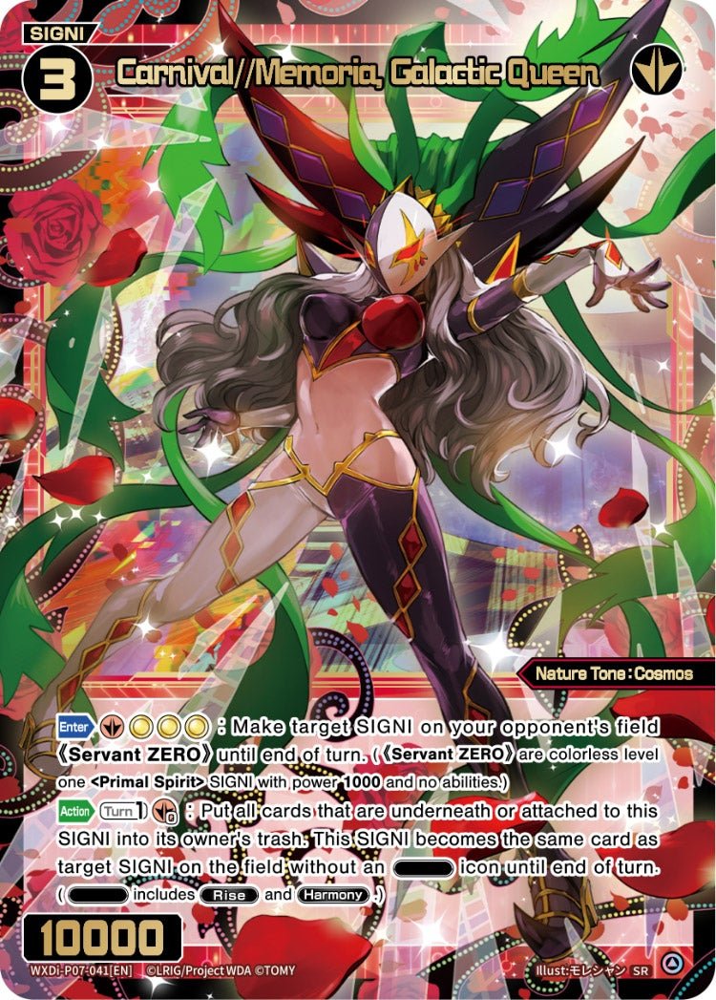

# Carnival//Memoria, Galactic Queen

## Thông tin lá

| Trường | Giá trị |
| --- | --- |
| Mã in | WXDi-P07-041[EN] |
| Set | WXDi-P07[EN] |
| Số thứ tự | 041 |
| Loại thẻ | SIGNI |
| Vị trí | Main Deck |
| Số bản | — (set booster, không áp dụng) |
| Màu | Đỏ |
| Độ hiếm | SR,SRP |
| Minh họa | モレシャン |
| Level | 3 |
| Limit | — |
| Power | 10000 |
| LRIG type / Class | Nature Tone：Cosmos |
| Team / Master | — |
| Cost | — |
| Grow cost | — |
| Use timing | — |
| Life Burst | Không |

## Card text chính thức

[Enter] {Red} {Coin Icon} {Coin Icon} {Coin Icon}: Make target SIGNI on your opponent's field 《Servant ZERO》 until end of turn. (《Servant ZERO》 are colorless level one <Primal Spirit> SIGNI with power 1000 and no abilities.)
[Action] {1/Turn} {Redx0}: Put all cards that are underneath or attached to this SIGNI into its owner's trash. This SIGNI becomes the same card as target SIGNI on the field without an 【　　】 icon until end of turn. (【　　】 includes [Rise] and [Harmony].)

## Power text / Life Burst

—

## Ghi chú minh họa
Artist: モレシャン. Ảnh SR được tải từ Card List tiếng Anh.

## FAQ chính thức

**Q. If I use the [Enter] ability to make an opponent's SIGNI to 《Servant ZERO》, does the effect that changes the power, increases or decreases the power, or gains abilities that the original SIGNI received take over?**
A. When a SIGNI on the field becomes another SIGNI, it does not take over any effects that change its power, increase or decrease its power or gain abilities that it was receiving.

**Q. What does the [Action] ability make this SIGNI the same card as?**
A. This card will be the same card as the targeted SIGNI. It is not the card that was attached card or underneath card.

**Q. May the [Action] ability only be used if there are cards attached to or under this SIGNI?**
A. No. This card can be used [Action] ability even if neither is attached or under cards.

## Ảnh biến thể

- [SRP](../images/WXDi-P07-041P-EN.jpg)

## Nguồn
[Card List/FAQ chính thức](https://www.takaratomy.co.jp/products/en.wixoss/card/card.html?card_no=WXDi-P07-041%5BEN%5D ) · [Ảnh thẻ](https://www.takaratomy.co.jp/products/en.wixoss/card/thumb/WXDi-P07-041%5BEN%5D.jpg)
