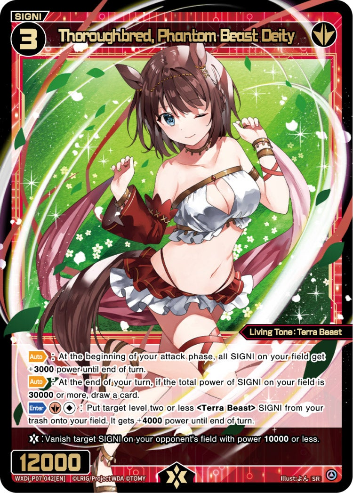

# Thoroughbred, Phantom Beast Deity

## Thông tin lá

| Trường | Giá trị |
| --- | --- |
| Mã in | WXDi-P07-042[EN] |
| Set | WXDi-P07[EN] |
| Số thứ tự | 042 |
| Loại thẻ | SIGNI |
| Vị trí | Main Deck |
| Số bản | — (set booster, không áp dụng) |
| Màu | Đỏ |
| Độ hiếm | SR,SRP |
| Minh họa | よん |
| Level | 3 |
| Limit | — |
| Power | 12000 |
| LRIG type / Class | Living Tone：Terra Beast |
| Team / Master | — |
| Cost | — |
| Grow cost | — |
| Use timing | — |
| Life Burst | Có |

## Card text chính thức

[Auto]: At the beginning of your attack phase, all SIGNI on your field get +3000 power until end of turn.
[Auto]: At the end of your turn, if the total power of SIGNI on your field is 30000 or more, draw a card.
[Enter] {Red} {Colorless}: Put target level two or less <Terra Beast> SIGNI from your trash onto your field. It gets +4000 power until end of turn.

## Power text / Life Burst

Vanish target SIGNI on your opponent's field with power 10000 or less.

## Ghi chú minh họa
Artist: よん. Ảnh SR được tải từ Card List tiếng Anh.

## FAQ chính thức

**Q. Does a new SIGNI that enters my field after the first [Auto] ability is activated get +3000 power?**
A. No, it cannot get +3000 power. Only the SIGNI that was on your field when this ability is activated get +3000 power.

**Q. When adding up the power from the second [Auto] ability, is the power added by the first [Auto] ability also included in the calculation?**
A. Yes, when the [Auto] ability that triggers at the end of the turn triggers, the effect of "until end of turn" still remains. In the end phase, the ability that triggers at "at the end of turn" is triggered first, the turn player discards so that who has six cards in player's hand, and then the effect of "until end of turn" ends.

## Ảnh biến thể

- [SRP](../images/WXDi-P07-042P-EN.jpg)

## Nguồn
[Card List/FAQ chính thức](https://www.takaratomy.co.jp/products/en.wixoss/card/card.html?card_no=WXDi-P07-042%5BEN%5D ) · [Ảnh thẻ](https://www.takaratomy.co.jp/products/en.wixoss/card/thumb/WXDi-P07-042%5BEN%5D.jpg)
