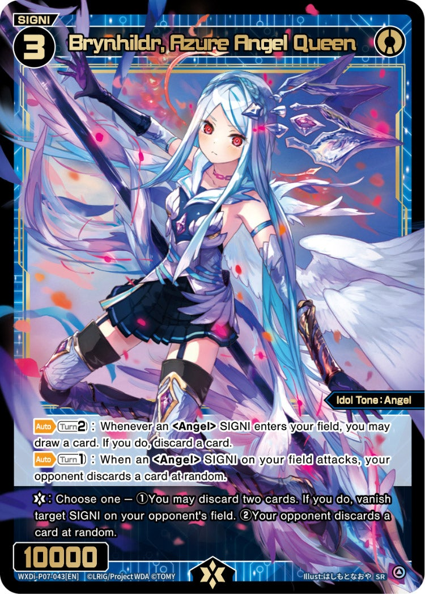

# Brynhildr, Azure Angel Queen

## Thông tin lá

| Trường | Giá trị |
| --- | --- |
| Mã in | WXDi-P07-043[EN] |
| Set | WXDi-P07[EN] |
| Số thứ tự | 043 |
| Loại thẻ | SIGNI |
| Vị trí | Main Deck |
| Số bản | — (set booster, không áp dụng) |
| Màu | Xanh dương |
| Độ hiếm | SR,SRP |
| Minh họa | はしもとなおや |
| Level | 3 |
| Limit | — |
| Power | 10000 |
| LRIG type / Class | Idol Tone：Angel |
| Team / Master | — |
| Cost | — |
| Grow cost | — |
| Use timing | — |
| Life Burst | Có |

## Card text chính thức

[Auto] {2/Turn}: Whenever an <Angel> SIGNI enters your field, you may draw a card. If you do, discard a card.
[Auto] {1/Turn}: When an <Angel> SIGNI on your field attacks, your opponent discards a card at random.

## Power text / Life Burst

Choose one — ①You may discard two cards. If you do, vanish target SIGNI on your opponent's field. ②Your opponent discards a card at random.

## Ghi chú minh họa
Artist: はしもとなおや. Ảnh SR được tải từ Card List tiếng Anh.

## FAQ chính thức

**Q. Does this SIGNI trigger its [Auto] ability when it itself enters the field or attacks?**
A. Yes, both [Auto] abilities can be triggered by this SIGNI itself.

## Ảnh biến thể

- [SRP](../images/WXDi-P07-043P-EN.jpg)

## Nguồn
[Card List/FAQ chính thức](https://www.takaratomy.co.jp/products/en.wixoss/card/card.html?card_no=WXDi-P07-043%5BEN%5D ) · [Ảnh thẻ](https://www.takaratomy.co.jp/products/en.wixoss/card/thumb/WXDi-P07-043%5BEN%5D.jpg)
