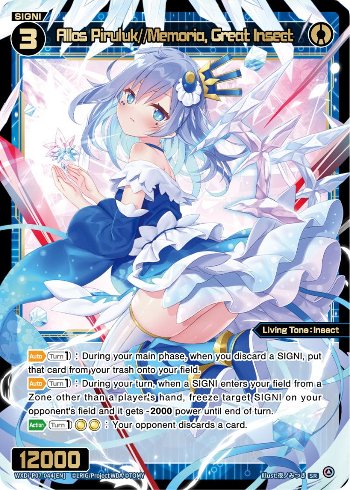

# Allos Piruluk//Memoria, Great Insect

## Thông tin lá

| Trường | Giá trị |
| --- | --- |
| Mã in | WXDi-P07-044[EN] |
| Set | WXDi-P07[EN] |
| Số thứ tự | 044 |
| Loại thẻ | SIGNI |
| Vị trí | Main Deck |
| Số bản | — (set booster, không áp dụng) |
| Màu | Xanh dương |
| Độ hiếm | SR,SRP |
| Minh họa | 夜ノみつき |
| Level | 3 |
| Limit | — |
| Power | 12000 |
| LRIG type / Class | Living Tone：Insect |
| Team / Master | — |
| Cost | — |
| Grow cost | — |
| Use timing | — |
| Life Burst | Không |

## Card text chính thức

[Auto] {1/Turn}: During your main phase, when you discard a SIGNI, put that card from your trash onto your field.
[Auto] {1/Turn}: During your turn, when a SIGNI enters your field from a Zone other than a player's hand, freeze target SIGNI on your opponent's field and it gets -2000 power until end of turn.
[Action] {1/Turn} {Coin Icon} {Coin Icon}: Your opponent discards a card.

## Power text / Life Burst

—

## Ghi chú minh họa
Artist: 夜ノみつき. Ảnh SR được tải từ Card List tiếng Anh.

## FAQ chính thức

**Q. If the first [Auto] ability puts a SIGNI on the field, does the second [Auto] ability trigger?**
A. Yes, it will trigger. But if you cannot put a SIGNI by the first [Auto] ability because it cannot be put to exceed the level or total limit, the second [Auto] ability cannot be trigger.

## Ảnh biến thể

- [SRP](../images/WXDi-P07-044P-EN.jpg)

## Nguồn
[Card List/FAQ chính thức](https://www.takaratomy.co.jp/products/en.wixoss/card/card.html?card_no=WXDi-P07-044%5BEN%5D ) · [Ảnh thẻ](https://www.takaratomy.co.jp/products/en.wixoss/card/thumb/WXDi-P07-044%5BEN%5D.jpg)
