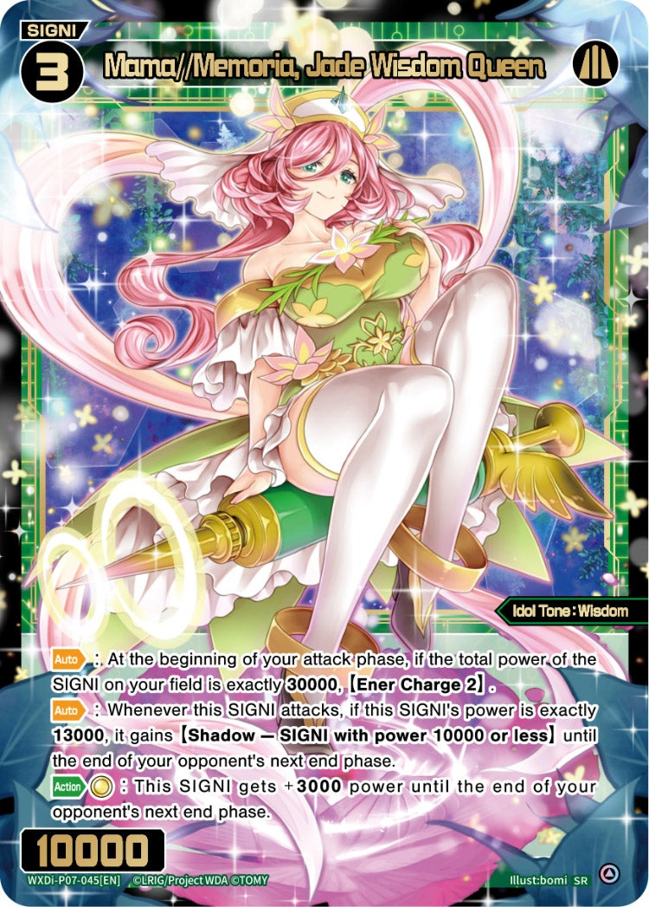

# Mama//Memoria, Jade Wisdom Queen

## Thông tin lá

| Trường | Giá trị |
| --- | --- |
| Mã in | WXDi-P07-045[EN] |
| Set | WXDi-P07[EN] |
| Số thứ tự | 045 |
| Loại thẻ | SIGNI |
| Vị trí | Main Deck |
| Số bản | — (set booster, không áp dụng) |
| Màu | Xanh lá |
| Độ hiếm | SR,SRP |
| Minh họa | bomi |
| Level | 3 |
| Limit | — |
| Power | 10000 |
| LRIG type / Class | Idol Tone：Wisdom |
| Team / Master | — |
| Cost | — |
| Grow cost | — |
| Use timing | — |
| Life Burst | Không |

## Card text chính thức

[Auto]: At the beginning of your attack phase, if the total power of the SIGNI on your field is 30000 or more, 【Ener Charge 2】.
[Auto]: Whenever this SIGNI attacks, if this SIGNI's power is exactly 13000, it gains 【Shadow — SIGNI with power 10000 or less】 until the end of your opponent's next end phase.
[Action] {Coin Icon}: This SIGNI gets +3000 power until the end of your opponent's next end phase.

## Power text / Life Burst

—

## Ghi chú minh họa
Artist: bomi. Ảnh SR được tải từ Card List tiếng Anh.

## FAQ chính thức

**Q. Does the power have to be exactly 30000 or 13000 in order for the [Auto] abilities to process the effect?**
A. Yes, [Auto] abilities just have to be that power.

**Q. this SIGNI gained 【Shadow — SIGNI with power 10000 or less】 with the second [Auto] ability when it attacked. If this SIGNI's power changes afterwards and is no longer 13000 power, what happens to 【Shadow — SIGNI with power 10000 or less】?**
A. Even if your SIGNI's power changes, it will still gain 【Shadow — SIGNI with power 10000 or less】 until the end of your next opponent's turn. The power value is only checked when the [Auto] ability is triggered.

**Q. What is the ability of 【Shadow — SIGNI with power 10000 or less】?**
A. A SIGNI with 【Shadow — SIGNI with power 10000 or less】 is not targeted by the abilities or effects of a SIGNI with power 10000 or less. It is likewise not targeted by the Life Burst of a SIGNI with power 10000 or less.

**Q. May the [Action] ability be used more than once in the same turn?**
A. Yes, can be used more than once if you can pay the costs.

## Ảnh biến thể

- [SRP](../images/WXDi-P07-045P-EN.jpg)

## Nguồn
[Card List/FAQ chính thức](https://www.takaratomy.co.jp/products/en.wixoss/card/card.html?card_no=WXDi-P07-045%5BEN%5D ) · [Ảnh thẻ](https://www.takaratomy.co.jp/products/en.wixoss/card/thumb/WXDi-P07-045%5BEN%5D.jpg)
