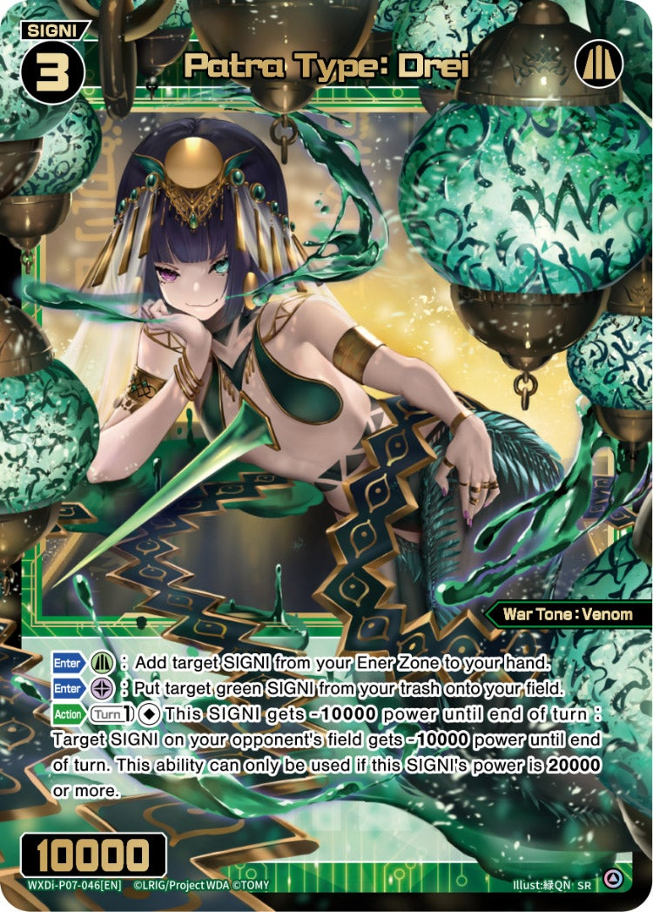

# Patra Type: Drei

## Thông tin lá

| Trường | Giá trị |
| --- | --- |
| Mã in | WXDi-P07-046[EN] |
| Set | WXDi-P07[EN] |
| Số thứ tự | 046 |
| Loại thẻ | SIGNI |
| Vị trí | Main Deck |
| Số bản | — (set booster, không áp dụng) |
| Màu | Xanh lá |
| Độ hiếm | SR,SRP |
| Minh họa | 緑QN |
| Level | 3 |
| Limit | — |
| Power | 10000 |
| LRIG type / Class | War Tone：Venom |
| Team / Master | — |
| Cost | — |
| Grow cost | — |
| Use timing | — |
| Life Burst | Không |

## Card text chính thức

[Enter] {Green}: Add target SIGNI from your Ener Zone to your hand.
[Enter] {Black}: Put target green SIGNI from your trash onto your field.
[Action] {1/Turn} {Colorless} This SIGNI gets -10000 power until end of turn: Target SIGNI on your opponent's field gets -10000 power until end of turn. This ability can only be used if this SIGNI's power is 20000 or more.

## Power text / Life Burst

—

## Ghi chú minh họa
Artist: 緑QN. Ảnh SR được tải từ Card List tiếng Anh.

## FAQ chính thức

**Q. I paid the cost of the second [Auto] ability with 《Green Gas Type: Eins》, which is both black and green. May I put it from the trash on the field with that ability?**
A. Yes, you can.

## Ảnh biến thể

- [SRP](../images/WXDi-P07-046P-EN.jpg)

## Nguồn
[Card List/FAQ chính thức](https://www.takaratomy.co.jp/products/en.wixoss/card/card.html?card_no=WXDi-P07-046%5BEN%5D ) · [Ảnh thẻ](https://www.takaratomy.co.jp/products/en.wixoss/card/thumb/WXDi-P07-046%5BEN%5D.jpg)
