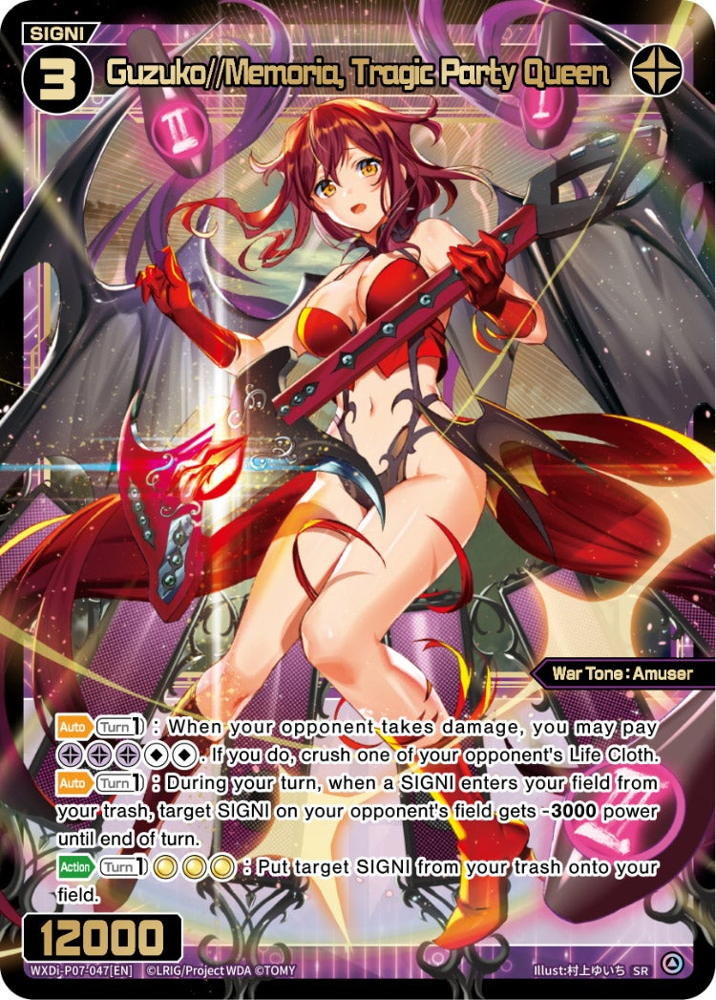

# Guzuko//Memoria, Tragic Party Queen

## Thông tin lá

| Trường | Giá trị |
| --- | --- |
| Mã in | WXDi-P07-047[EN] |
| Set | WXDi-P07[EN] |
| Số thứ tự | 047 |
| Loại thẻ | SIGNI |
| Vị trí | Main Deck |
| Số bản | — (set booster, không áp dụng) |
| Màu | Đen |
| Độ hiếm | SR,SRP |
| Minh họa | 村上ゆいち |
| Level | 3 |
| Limit | — |
| Power | 12000 |
| LRIG type / Class | War Tone：Amuser |
| Team / Master | — |
| Cost | — |
| Grow cost | — |
| Use timing | — |
| Life Burst | Không |

## Card text chính thức

[Auto] {1/Turn}: When your opponent takes damage, you may pay {Black} {Black} {Black} {Colorless} {Colorless}. If you do, crush one of your opponent's Life Cloth.
[Auto] {1/Turn}: During your turn, when a SIGNI enters your field from your trash, target SIGNI on your opponent's field gets -3000 power until end of turn.
[Action] {1/Turn} {Coin Icon} {Coin Icon} {Coin Icon}: Put target SIGNI from your trash onto your field.

## Power text / Life Burst

—

## Ghi chú minh họa
Artist: 村上ゆいち. Ảnh SR được tải từ Card List tiếng Anh.

## FAQ chính thức

**Q. My opponent took damage from a SIGNI attack and my opponent crushed a Life Cloth. Which triggers first, the first [Auto] ability or the Life Burst of the crushed Life Cloth?**
A. They trigger the same time and resolve from the turn player first. If you crush a your opponent's Life Cloth on your attack, you are the turn player, so this SIGNI's [Auto] ability triggers first. If your opponent takes damage on your opponent's turn due to some effect, their Life Burst triggers first. In that case, this SIGNI's [Auto] ability is triggered even if the Life Burst causes this SIGNI to leave the field.

**Q. One of my opponent's Life Cloth was crushed by the effect "Crush one of your opponent's Life Cloth.". Does the first [Auto] ability trigger?**
A. No, it does not trigger. If a Life Cloth is crushed as a result of taking damage, the [Auto] ability is triggered, but if it is crushed by "Crush one of your opponent's Life Cloth." effect, it cannot be trigger because it is not damaged.

## Ảnh biến thể

- [SRP](../images/WXDi-P07-047P-EN.jpg)

## Nguồn
[Card List/FAQ chính thức](https://www.takaratomy.co.jp/products/en.wixoss/card/card.html?card_no=WXDi-P07-047%5BEN%5D ) · [Ảnh thẻ](https://www.takaratomy.co.jp/products/en.wixoss/card/thumb/WXDi-P07-047%5BEN%5D.jpg)
