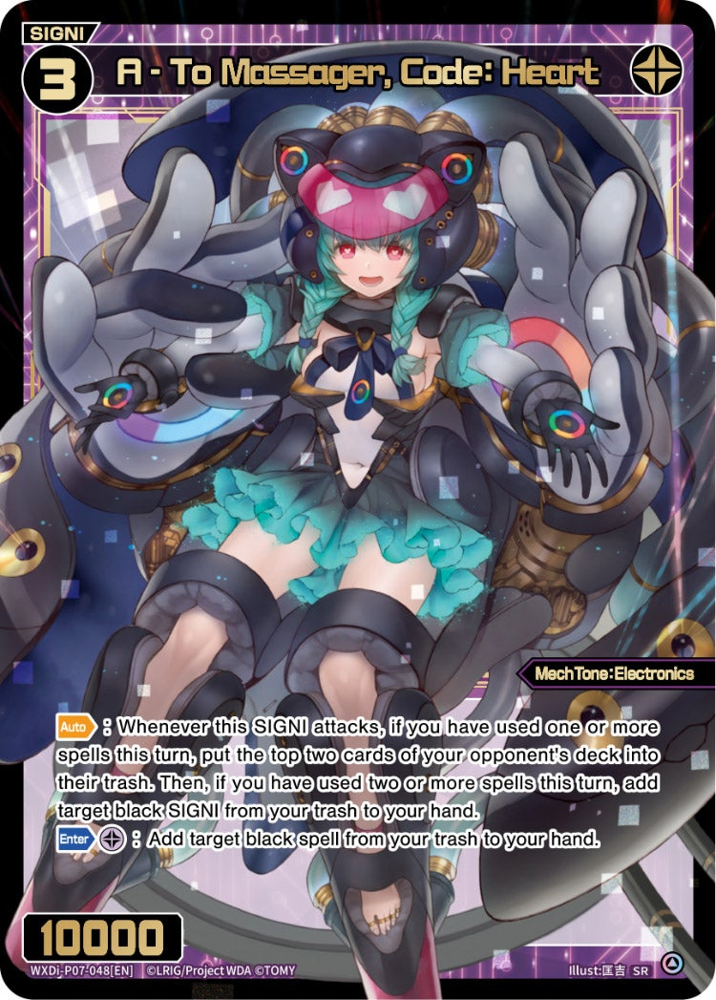

# A - To Massager, Code: Heart

## Thông tin lá

| Trường | Giá trị |
| --- | --- |
| Mã in | WXDi-P07-048[EN] |
| Set | WXDi-P07[EN] |
| Số thứ tự | 048 |
| Loại thẻ | SIGNI |
| Vị trí | Main Deck |
| Số bản | — (set booster, không áp dụng) |
| Màu | Đen |
| Độ hiếm | SR,SRP |
| Minh họa | 匡吉 |
| Level | 3 |
| Limit | — |
| Power | 10000 |
| LRIG type / Class | Mech Tone：Electronics |
| Team / Master | — |
| Cost | — |
| Grow cost | — |
| Use timing | — |
| Life Burst | Không |

## Card text chính thức

[Auto]: Whenever this SIGNI attacks, if you have used one or more spells this turn, put the top two cards of your opponent's deck into their trash. Then, if you used two or more spells this turn, add target black SIGNI from your trash to your hand.
[Enter] {Black}: Add target black spell from your trash to your hand.

## Power text / Life Burst

—

## Ghi chú minh họa
Artist: 匡吉. Ảnh SR được tải từ Card List tiếng Anh.

## FAQ chính thức

**Q. After I used one Spell, I put this SIGNI on my field and attacked. Does the [Auto] ability trigger?**
A. Yes, triggered. It is not necessary for this SIGNI to be on the field when you use a spell, only to check if you have used a spell this turn.

**Q. If I use two or more spells and then attack with this SIGNI, does the [Auto] ability trigger both the effect of using one or more spells and the effect of using two or more spells?**
A. Yes, both effects are processed. The effects are processed from the top, so if one or more spells have been used first, followed by if two or more spells have been used next.

## Ảnh biến thể

- [SRP](../images/WXDi-P07-048P-EN.jpg)

## Nguồn
[Card List/FAQ chính thức](https://www.takaratomy.co.jp/products/en.wixoss/card/card.html?card_no=WXDi-P07-048%5BEN%5D ) · [Ảnh thẻ](https://www.takaratomy.co.jp/products/en.wixoss/card/thumb/WXDi-P07-048%5BEN%5D.jpg)
