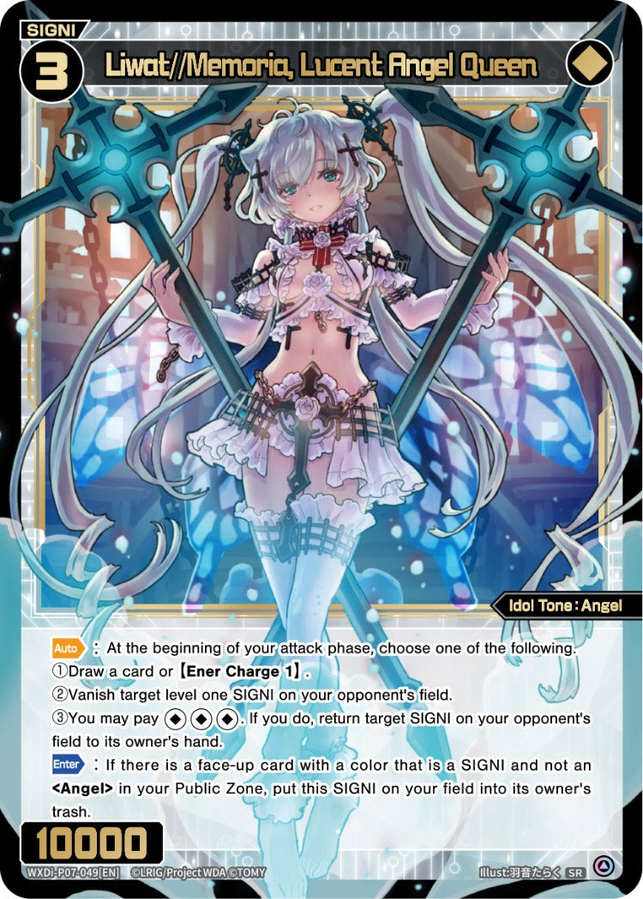

# Liwat//Memoria, Lucent Angel Queen

## Thông tin lá

| Trường | Giá trị |
| --- | --- |
| Mã in | WXDi-P07-049[EN] |
| Set | WXDi-P07[EN] |
| Số thứ tự | 049 |
| Loại thẻ | SIGNI |
| Vị trí | Main Deck |
| Số bản | — (set booster, không áp dụng) |
| Màu | Không màu |
| Độ hiếm | SR,SRP |
| Minh họa | 羽音たらく |
| Level | 3 |
| Limit | — |
| Power | 10000 |
| LRIG type / Class | Idol Tone：Angel |
| Team / Master | — |
| Cost | — |
| Grow cost | — |
| Use timing | — |
| Life Burst | Không |

## Card text chính thức

[Auto]: At the beginning of your attack phase, choose one of the following.
①Draw a card or 【Ener Charge 1】.
②Vanish target level one SIGNI on your opponent's field.
③You may pay {Colorless} {Colorless} {Colorless}. If you do, return target SIGNI on your opponent's field to its owner's hand.
[Enter]: If there is a face-up card with a color that is a SIGNI and not an <Angel> in your Public Zone, put this SIGNI on your field into its owner's trash.

## Power text / Life Burst

—

## Ghi chú minh họa
Artist: 羽音たらく. Ảnh SR được tải từ Card List tiếng Anh.

## FAQ chính thức

**Q. What happens if a face-up SIGNI of a colour other than <Angel> enters your field after this SIGNI enters the field?**
A. Nothing happens. Only when the [Enter] ability is triggered, it checked if there is a SIGNI that meets the conditions.

## Ảnh biến thể

- [SRP](../images/WXDi-P07-049P-EN.jpg)

## Nguồn
[Card List/FAQ chính thức](https://www.takaratomy.co.jp/products/en.wixoss/card/card.html?card_no=WXDi-P07-049%5BEN%5D ) · [Ảnh thẻ](https://www.takaratomy.co.jp/products/en.wixoss/card/thumb/WXDi-P07-049%5BEN%5D.jpg)
