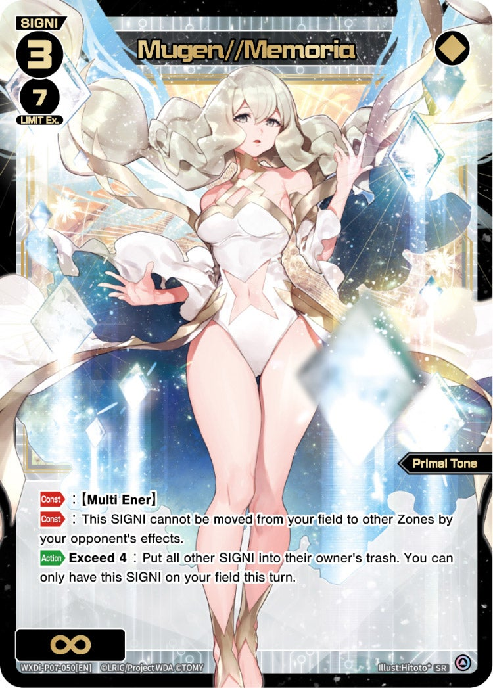

# Mugen//Memoria

## Thông tin lá

| Trường | Giá trị |
| --- | --- |
| Mã in | WXDi-P07-050[EN] |
| Set | WXDi-P07[EN] |
| Số thứ tự | 050 |
| Loại thẻ | SIGNI |
| Vị trí | Main Deck |
| Số bản | — (set booster, không áp dụng) |
| Màu | Không màu |
| Độ hiếm | SR,SRP |
| Minh họa | Hitoto* |
| Level | 3 |
| Limit | 7 |
| Power | 0 |
| LRIG type / Class | Primal Tone |
| Team / Master | — |
| Cost | — |
| Grow cost | — |
| Use timing | — |
| Life Burst | Không |

## Card text chính thức

[Constant]: 【Multi Ener】
[Constant]: This SIGNI cannot be moved from your field to other Zones by your opponent's effects.
[Action] Exceed 4: Put all other SIGNI into their owner's trash. You can only have this SIGNI on your field this turn.

## Power text / Life Burst

—

## Ghi chú minh họa
Artist: Hitoto*. Ảnh SR được tải từ Card List tiếng Anh.

## FAQ chính thức

**Q. What does ∞ power mean?**
A. SIGNI with this power have a higher power than any other SIGNI. When SINIG with ∞ power battle each other, the result is the same as if SIGNI with the same power battled each other. Even if it gets an effect that adds or subtracts power to a SIGNI with ∞ power, its power remains unchanged at ∞.

**Q. This SIGNI gains the "become 0 power" effect. Will this SIGNI be vanished?**
A. Yes, it will be vanished by Rule-based action. If the effect is to change the power to a specific value, this SIGNI's power will be that value. Due to the [Constant] ability, this SIGNI will not be moved from the field to another zone by your opponent's effect, but it will be vanished due to Rule-based action if its power is become 0 or less.

**Q. Does the [Action] ability also put the SIGNI in the Ener zone into the trash?**
A. No, it is not. If an effect affects a SIGNI without specifying specific zones, it affects only the SIGNI on the field.

**Q. After using the [Action] ability, this SIGNI has left the field. Will I be able to put SIGNI on my field?**
A. No, you cannot. This effect continues to apply even if this SIGNI leaves the field after using its [Action] Ability. Also, if you return this SIGNI to your hand, it is treated as a different SIGNI when it moves from one zone to another zone, so you cannot put this Signet itself on your field again.

## Ảnh biến thể

- [SRP](../images/WXDi-P07-050P-EN.jpg)

## Nguồn
[Card List/FAQ chính thức](https://www.takaratomy.co.jp/products/en.wixoss/card/card.html?card_no=WXDi-P07-050%5BEN%5D ) · [Ảnh thẻ](https://www.takaratomy.co.jp/products/en.wixoss/card/thumb/WXDi-P07-050%5BEN%5D.jpg)
