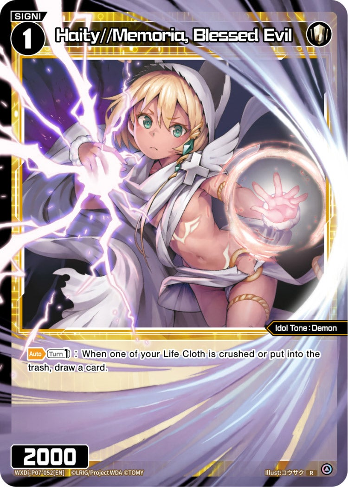

# Haity//Memoria, Blessed Evil

## Thông tin lá

| Trường | Giá trị |
| --- | --- |
| Mã in | WXDi-P07-052[EN] |
| Set | WXDi-P07[EN] |
| Số thứ tự | 052 |
| Loại thẻ | SIGNI |
| Vị trí | Main Deck |
| Số bản | — (set booster, không áp dụng) |
| Màu | Trắng |
| Độ hiếm | R,R(P) |
| Minh họa | コウサク |
| Level | 1 |
| Limit | — |
| Power | 2000 |
| LRIG type / Class | Idol Tone：Demon |
| Team / Master | — |
| Cost | — |
| Grow cost | — |
| Use timing | — |
| Life Burst | Không |

## Card text chính thức

[Auto] {1/Turn}: When one of your Life Cloth is crushed or put into the trash, draw a card.

## Power text / Life Burst

—

## Ghi chú minh họa
Artist: コウサク. Ảnh R được tải từ Card List tiếng Anh.

## FAQ chính thức

**Q. If my Life Cloth is crushed and that card has Life Burst, which triggers first, this SIGNI's [Auto] ability or Life Burst?**
A. Both will be abilities triggered by you, so you can resolve them one at a time in any order you wish.

## Ảnh biến thể

- [R(P)](../images/WXDi-P07-052P-EN.jpg)

## Nguồn
[Card List/FAQ chính thức](https://www.takaratomy.co.jp/products/en.wixoss/card/card.html?card_no=WXDi-P07-052%5BEN%5D ) · [Ảnh thẻ](https://www.takaratomy.co.jp/products/en.wixoss/card/thumb/WXDi-P07-052%5BEN%5D.jpg)
