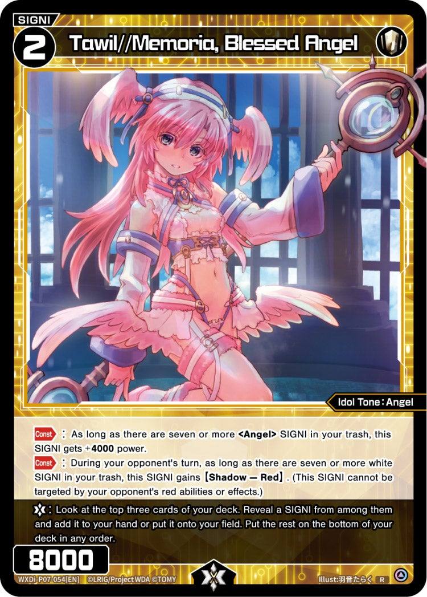

# Tawil//Memoria, Blessed Angel

## Thông tin lá

| Trường | Giá trị |
| --- | --- |
| Mã in | WXDi-P07-054[EN] |
| Set | WXDi-P07[EN] |
| Số thứ tự | 054 |
| Loại thẻ | SIGNI |
| Vị trí | Main Deck |
| Số bản | — (set booster, không áp dụng) |
| Màu | Trắng |
| Độ hiếm | R,R(P) |
| Minh họa | 羽音たらく |
| Level | 2 |
| Limit | — |
| Power | 8000 |
| LRIG type / Class | Idol Tone：Angel |
| Team / Master | — |
| Cost | — |
| Grow cost | — |
| Use timing | — |
| Life Burst | Có |

## Card text chính thức

[Constant]: As long as there are seven or more <Angel> SIGNI in your trash, this SIGNI gets +4000 power.
[Constant]: During your opponent's turn, as long as there are seven or more white SIGNI in your trash, this SIGNI gains 【Shadow — Red】. (This SIGNI cannot be targeted by your opponent's red abilities or effects.)

## Power text / Life Burst

Look at the top three cards of your deck. Reveal a SIGNI from among them and add it to your hand or put it onto your field. Put the rest on the bottom of your deck in any order.

## Ghi chú minh họa
Artist: 羽音たらく. Ảnh R được tải từ Card List tiếng Anh.

## FAQ chính thức

**Q. If there are seven or more white <Angel> SIGNI in my trash, does this card gains both effects?**
A. Yes, the conditions for both [Constant] abilities are met.

**Q. What is the ability of 【Shadow-Red】?**
A. SIGNI with 【Shadow-Red】 is not targeted by red cards such as red SIGNI, spells or LRIG.

## Ảnh biến thể

- [R(P)](../images/WXDi-P07-054P-EN.jpg)

## Nguồn
[Card List/FAQ chính thức](https://www.takaratomy.co.jp/products/en.wixoss/card/card.html?card_no=WXDi-P07-054%5BEN%5D ) · [Ảnh thẻ](https://www.takaratomy.co.jp/products/en.wixoss/card/thumb/WXDi-P07-054%5BEN%5D.jpg)
